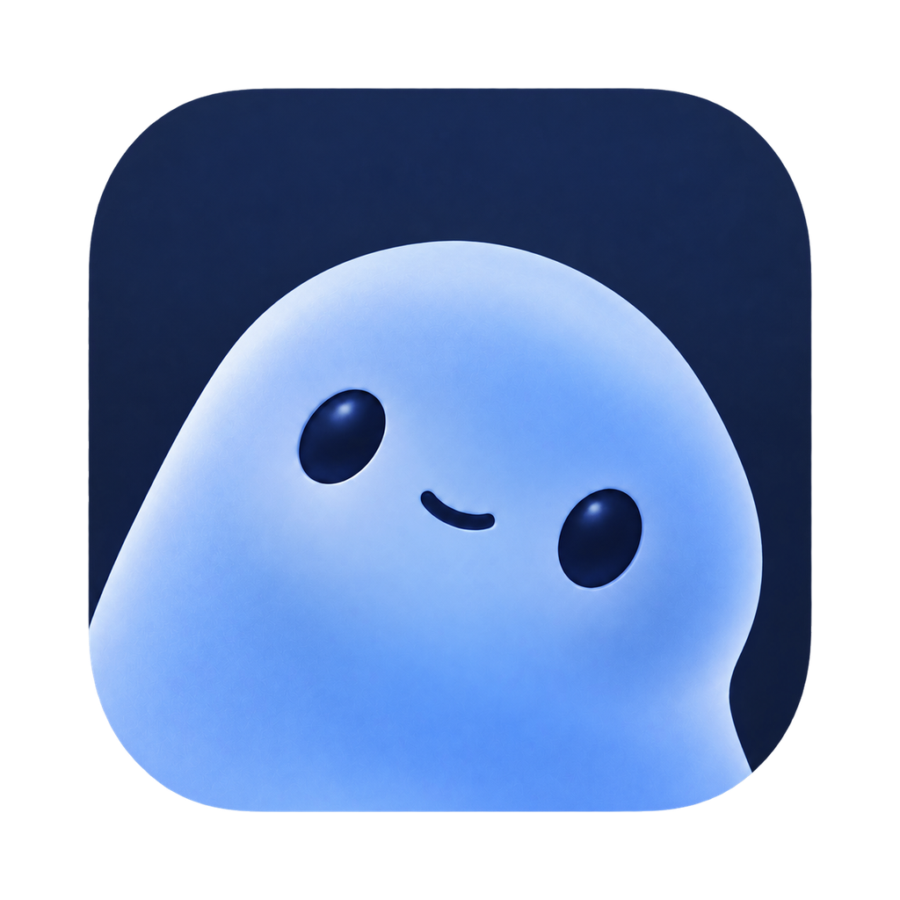

<div align="center">

# KulaHere



**macOS 原生效率入口 · 聚焦搜索 · 本地记忆 · 智能助手 · MCP 扩展**  
*A Native macOS Productivity Launcher & AI Workspace built with SwiftUI & AppKit*

<br />

<!-- Row 1: Platform & Languages -->
[](https://apple.com/macos)
[](https://swift.org)
[](https://developer.apple.com/xcode/swiftui/)
[](https://developer.apple.com/documentation/appkit)
[](https://www.typescriptlang.org)
[](https://nodejs.org)

<!-- Row 2: Architecture & Protocols -->
[-6A1B9A?style=flat-square)](docs/native-tools-and-mcp.md)
[](docs/agent-runtime.md)
[](docs/design-system.md)
[](https://www.figma.com/design/tmVnTyCb2sz5egNQ7We9Sw/Asky)
[](Packages/KulaCore)

<!-- Row 3: AI & Models -->
[](https://openai.com)
[](docs/validation/2026-10-09-deepseek.md)
[](Packages/KulaCore)

<!-- Row 4: Quality & Verification -->
[](Packages/KulaCore)
[](docs/validation/2026-10-09-m0.md)
[](project.yml)
[](README.md)

<br />

[🇨🇳 中文文档](#中文) &nbsp;&nbsp;|&nbsp;&nbsp; [🇬🇧 English Documentation](#english)

</div>

---

<a id="中文"></a>

## 中文

应用图标采用白底渐变光带 Logo；菜单栏使用同一轮廓的 14 pt 单色模板图标，随系统适配明暗外观。原图位于 `App/Branding/Logo.png`，应用与菜单栏资源位于 `App/Assets.xcassets`。

### 📌 项目简介

KulaHere 是一个规划中的 macOS 原生效率入口，采用 SwiftUI 与 AppKit 打造。以极速搜索与确定性系统工具为基石，通过本地 AI、个人记忆和情境提醒重塑桌面日常工作流。

当前仓库包含首版完整代码：原生 App、核心 Swift 业务包、Pi Agent 宿主与 MCP Bridge，可直接构建并运行，自动化测试已全部通过。DeepSeek 基础对话与历史重开已通过真实模型验证（见 [DeepSeek 验证记录](docs/validation/2026-10-09-deepseek.md)）。完整界面流程、真实系统权限及其他模型能力持续验收中（详见 [M0 验证记录](docs/validation/2026-10-09-m0.md)）。

```
┌─────────────────────────────────────────────────────────────┐
│                       KulaHere Desktop                      │
├──────────────────────────────┬──────────────────────────────┤
│    🔍 桌面入口 (Launcher)    │     🤖 AI 助手 (Assistant)   │
│   应用 / 文件 / 标签页 / 剪贴板 │   自然语言对话 / 截图 / 工具调用  │
├──────────────────────────────┴──────────────────────────────┤
│                   🧠 个人上下文 (Personal Context)            │
│                  本地记忆 · 证据提醒 · 隐私沙箱              │
└─────────────────────────────────────────────────────────────┘
```

---

### 🚀 核心能力

#### 🔍 桌面聚焦搜索 `Launcher`
``
``
``
``
`-purple?style=flat-square)`
``

- `🏷️ [胶囊外观]` 严格按 [Figma Field 22:348](https://www.figma.com/design/tmVnTyCb2sz5egNQ7We9Sw/Asky?node-id=22-348) 实现为 720 × 64 pt 胶囊输入框，采用原生 Regular Liquid Glass 与 70% 白/黑语义底色，保留定向边缘高光及独立投影；底色随系统明暗主题切换，原生玻璃自适应背景，启用“减少透明度”时回退为不透明背景。见 [Regular 玻璃验证记录](docs/validation/2026-10-10-launcher-regular-glass.md) 与 [聚焦搜索记录](docs/validation/2026-10-09-figma-search.md)。
- `🏷️ [别名匹配与关键词]` 完整输入关键词（如 `go`，不加空格）时，对应命令独立展示在最前面的「别名匹配」组并默认选中；快捷指令组亦排在普通应用结果前。关键词加空格后进入查询模式。预设包含 Google（`go`）与 ChatGPT（`chat`），支持网址直达（如 `chatgpt.com`，缺省协议自动补充 HTTPS）。`chat 问题` 自动通过 URL 传递查询；已有配置在升级时自动迁移。
- `🏷️ [菜单项与分组]` 搜索结果同时存在两个及以上分类时展示分组标题；单分类隐藏标题并释放高度。菜单项按 [Figma 38:461](https://www.figma.com/design/tmVnTyCb2sz5egNQ7We9Sw/Asky?node-id=38-461) 采用 50 pt 行高、32 pt 图标、14 pt 标题、12 pt 路径与 16 pt 圆角。放大镜图标固定于右侧；输入框统一 28 pt 左右边距、64 pt 高度与 18 pt 字号。关键词模式下左侧显示浏览器图标，输入框仅显示正文；退格或按 `Escape` 退出关键词模式。见 [菜单项验证记录](docs/validation/2026-10-10-search-menu-item.md)。
- `🏷️ [窗口几何与滚动]` 浮窗顶部锚定于屏幕可用区域 12% 处；结果列表最多展示 8 项（400 pt 预算，含分类标题），底部与 Dock 预留安全间距；超出结果滚动浏览，隐藏滚动条，内容裁切于外壳圆角内。连续输入防抖合并至 100 ms。见 [搜索性能与窗口修复记录](docs/validation/2026-10-10-launcher-height-performance.md)。
- `🏷️ [交互与穿透隔离]` 鼠标光标位于输入区或列表区时均支持滚轮与触控板平滑滚动，保持输入焦点与键盘选择；键盘 `↑`/`↓` 自动滚入视野，边界处停止不循环。搜索外壳阻断滚动事件穿透，绝不误触背景窗口。
- `🏷️ [链接与 Chrome 书签]` 链接与「搜索书签」归并入「APP 应用」分组；支持检索 Chrome Default / Profile 本地书签，点击以系统默认浏览器打开，无需 Chrome 常驻运行且不读取历史记录。见 [链接与书签验证](docs/validation/2026-10-10-links-bookmarks.md)。
- `🏷️ [纯文本 AI 推导]` 普通搜索中无显式关键词且无本地结果的自然语言文本（如“你是谁啊”）默认选中 AI 意图，回车即可唤起对话；显式关键词、换算、计算与书签检索优先；输入期间绝不偷跑模型请求。AI 条目采用 32 pt 彩色白底圆角图标。
- `🏷️ [多语言应用搜索]` 支持 `.app` 文件名、Bundle 内核名及系统各语言本地化名称匹配（如“微信 / WeChat”、“钉钉 / DingTalk”、“飞书 / Lark”）。见 [应用名称搜索验证](docs/validation/2026-10-10-app-localized-search.md)。

---

#### 📋 原生剪贴板面板 `Clipboard Manager`
`-blue?style=flat-square)`
``
``
``
``
``

- `🏷️ [全局唤起]` 普通搜索不混杂剪贴板历史；通过快捷键 `Ctrl + Option + Command + V`（⌃⌥⌘V，支持在“设置 › 触发快捷键 › 剪贴板”中录制更改与检测冲突）或菜单栏呼出独立面板。见 [剪贴板快捷键设置记录](docs/validation/2026-10-10-clipboard-hotkey-setting.md)。
- `🏷️ [横向手势卡片]` 触控板或鼠标滚轮直接上下滚动即可横向滑动卡片列表（无需按住 Shift）；点击或拖拽卡片复制原始文本或图片。
- `🏷️ [智能悬停预览]` 鼠标悬停卡片即在面板下方 8 pt 展开完整预览层（居中对齐，贴边时自适应左右对齐）；图片保持同心圆角，长文本支持移入预览层滚动查阅。
- `🏷️ [一键直达粘贴]` 默认加粗描边高亮首张卡片，`←`/`→` 或 `↑`/`↓` 移动选择；回车直接复制并粘贴到当前前台应用（需辅助功能权限；未授权时降级为仅复制）。
- `🏷️ [来源识别与管理]` 卡片左上角根据来源应用 Bundle ID 呈现原生图标（支持未运行及名称本地化应用）；右键菜单支持固定或删除；顶部图钉切换窗口置顶；未置顶时点击面板外侧或按 `Escape` 即刻关闭。见 [剪贴板验证记录](docs/validation/2026-10-10-clipboard-panel.md)。

---

#### 🤖 AI 智能对话与工作区 `AI Workspace`
`-FF6F00?style=flat-square)`
``
``
``
``
``

- `🏷️ [按需进程架构]` 原生应用常驻，仅在发生明确 AI 对话请求时拉起 TypeScript Pi Agent 辅助进程，空闲超时自动退出释放资源，无后台冗余唤醒。
- `🏷️ [原生界面规范]` 遵循 Figma 43:1071 / 42:760 / 38:653 规范打造 720 × 640 pt 对话窗口，使用 Regular Liquid Glass 背景。顶部提供历史、新建、置顶及关闭控件；默认普通窗口层级，可随时置顶。
- `🏷️ [流畅动效与打字机]` 页面进入、返回及历史切换配备 240 ms 原生平滑动效；空白页问候语以 38 ms/字符逐字显现；系统开启“减少动态效果”时降级为 150 ms 渐隐无位移。见 [对话过渡验证](docs/validation/2026-10-10-ai-chat-motion.md)。
- `🏷️ [多模态附件流]` 输入框支持 `⌘V` 直接粘贴文本、图片或 Finder 文件，或通过 52 pt 规格卡片（Figma 42:852）拖拽上传；提供 1:1 图片缩略图、文件名与大小展示；发送后右对齐归档于气泡上方。
- `🏷️ [Markdown 排版]` 内置 MarkdownUI 2.4.1 原生解析渲染，支持代码块选择高亮、表格、列表与明暗双主题；采用 16 pt 标题与 14 pt 正文排版规范。见 [Markdown 验证记录](docs/validation/2026-10-10-chat-markdown.md)。
- `🏷️ [耗时回执与重写]` 生成期间左下角实时显示 `Work for …s`，回复完成与复制按钮对齐；意图澄清自动收束上文，避免多余消息气泡堆叠。
- `🏷️ [安全凭据存储]` API Key 严格加密存放于系统钥匙串；运行时内存复用凭据，退出即清空；对话窗口优雅处理钥匙串授权弹窗生命周期。见 [钥匙串与对话窗口验证](docs/validation/2026-10-09-keychain-window.md)。

---

#### 🛠️ 确定性工具与 Apple 生态 `ToolService`
``
``
``
``
``
``

- `🏷️ [绝对收敛门禁]` 所有系统读写必须经由 `Packages/KulaCore` 中的 ToolService，严禁在 App、AgentRuntime 或 MCPBridge 中直调系统底层接口。
- `🏷️ [官方接口集成]` 日程、提醒、备忘录、通讯录及短信均对接 macOS 官方应用与底层框架；精准区分日历应用与日历分类（如“大麦”），智能推选可写日历。
- `🏷️ [安全人工确认]` 短信等高敏感操作生成草稿后交由系统「信息」App，由用户最终确认并点击发送，杜绝无感越权发送。
- `🏷️ [渐进式权限管理]` 在“设置 › 更多设置 › 系统权限”中集中管理；首次工具调用按需触发系统授权；被拒后提供跳转系统偏好设置引导，返回 App 自动刷新状态。

---

#### 🔌 模型上下文协议扩展 `MCP Bridge`
``
`-blue?style=flat-square)`
``
``

- `🏷️ [双向协议桥接]` 内置标准 MCP Bridge，使第三方客户端（如 Claude Desktop 等）能够无缝复用 KulaHere 的本地工具服务。
- `🏷️ [独立隔离授权]` 外部 MCP 接入执行独立授权策略，与 Agent 运行时完全解耦，保障本地数据环境安全。

---

### 📂 目录结构与技术栈矩阵

| 目录 / Package | 角色定位 | 技术栈标签 | 核心职责与边界说明 |
| :--- | :--- | :--- | :--- |
| `App/Sources` | macOS 宿主应用 | `` `` `` | 启动器胶囊、AI 对话浮窗、剪贴板面板、设置中心 |
| `App/Assets.xcassets` | 应用资源库 | `` `` | 启动器内置图标、书签图标及系统矢量插图 |
| `Packages/KulaCore` | 核心引擎与安全服务 | `` `` `` | 路由仲裁、系统适配器、LocalStore、调度、记忆与 MCPGateway |
| `AgentRuntime` | Agent 独立运行时 | `` `` `` | 独立辅助进程，基于 stdio JSONL v1 协议通信，按需唤起与释放 |
| `MCPBridge` | MCP 协议网关 | `` `` | Model Context Protocol 原生桥接服务，支撑测试与外部生态接入 |
| `project.yml` | Xcode 工程配置 | `` `` | 声明式工程配置；动态生成 `KulaHere.xcodeproj`（工程不入库） |

---

### 📑 核心文档导航

| 专题文档 | 分类标签 | 核心定位与阅读重点 |
| :--- | :--- | :--- |
| [文档索引](docs/README.md) | `` | 文档阅读全景导航、权威内容定义与设计更新状态 |
| [V1 产品需求文档 (PRD)](docs/PRD.md) | `` | 产品范围基准、核心用户流程、默认行为与验收准则 |
| [产品框架与架构大纲](docs/framework.md) | `` | 技术选型全景、模块拓扑、数据流向、进程与接口边界 |
| [原生界面与设计系统](docs/design-system.md) | `` | Figma 变量体系、控件规范与 Liquid Glass 原生液态光学 |
| [Agent Runtime 规范](docs/agent-runtime.md) | `` | Pi 架构扩展、多模型接入、stdio JSONL 通信与生命周期 |
| [原生工具与 MCP 协议](docs/native-tools-and-mcp.md) | `` | 系统适配器体系、权限确认机制与外部 MCP 安全集成 |
| [数据、记忆与提醒](docs/data-and-memory.md) | `` | 本地持久化、来源溯源、隐私脱敏、清理策略与后台调度 |
| [资源生命周期与性能](docs/resource-lifecycle.md) | `` | 缓存配额、按需分页加载、内存及时释放与度量标准 |
| [实施规划与验收门槛](docs/implementation-and-validation.md) | `` | M0–M4 里程碑准入门槛、已知风险应对与端到端验收映射 |

---

### 🧪 已验证功能矩阵 `Validation Status`

仓库所有声明的能力均有对应实际测试日志支撑，拒绝未经验证的特性。

| 验证项 | 所属模块 | 规格标准 / 依赖 | 验证状态 | 详情记录 |
| :--- | :--- | :--- | :--- | :--- |
| **DeepSeek 模型真实对话** | `AgentRuntime` | `deepseek-flash` 真实 API | `` | [2026-10-09-deepseek.md](docs/validation/2026-10-09-deepseek.md) |
| **M0 阶段构建与基线** | `全工程` | 自动化测试 100% 通过 | `` | [2026-10-09-m0.md](docs/validation/2026-10-09-m0.md) |
| **聚焦搜索 720×64pt 胶囊** | `Launcher` | Figma Field 22:348 | `` | [2026-10-09-figma-search.md](docs/validation/2026-10-09-figma-search.md) |
| **Regular 液态玻璃光学底色** | `Theme` | 70% 语义明暗底色与高光 | `` | [2026-10-10-launcher-regular-glass.md](docs/validation/2026-10-10-launcher-regular-glass.md) |
| **剪贴板横向浏览与预览** | `Clipboard` | 触控板纵向滚横向、8pt 悬停 | `` | [2026-10-10-clipboard-panel.md](docs/validation/2026-10-10-clipboard-panel.md) |
| **剪贴板全局热键录制与状态** | `HotKey` | `⌃⌥⌘V` 录制、占用与恢复 | `` | [2026-10-10-clipboard-hotkey-setting.md](docs/validation/2026-10-10-clipboard-hotkey-setting.md) |
| **搜索窗口高度预算与性能** | `Launcher` | 最多 8 项 400pt / 100ms 防抖 | `` | [2026-10-10-launcher-height-performance.md](docs/validation/2026-10-10-launcher-height-performance.md) |
| **搜索菜单项 Figma 规范** | `Launcher` | Figma Spotlight 38:461 | `` | [2026-10-10-search-menu-item.md](docs/validation/2026-10-10-search-menu-item.md) |
| **Chrome 书签与网址检索** | `Search` | Profile 本地检索、默认浏览器 | `` | [2026-10-10-links-bookmarks.md](docs/validation/2026-10-10-links-bookmarks.md) |
| **应用多语言显示名搜索** | `Search` | 微信/WeChat、飞书/Lark 等 | `` | [2026-10-10-app-localized-search.md](docs/validation/2026-10-10-app-localized-search.md) |
| **AI 对话新版样式与附件卡片** | `Conversation` | 720×640 pt / Figma 42:852 | `` | [2026-10-10-ai-chat-refresh.md](docs/validation/2026-10-10-ai-chat-refresh.md) |
| **对话动效与无障碍降级** | `Animation` | 240ms 过渡 / 38ms 打字机 | `` | [2026-10-10-ai-chat-motion.md](docs/validation/2026-10-10-ai-chat-motion.md) |
| **历史搜索原生输入焦点** | `Conversation` | AppKit 原生文字布局 | `` | [2026-10-10-conversation-search-focus.md](docs/validation/2026-10-10-conversation-search-focus.md) |
| **MarkdownUI 2.4.1 原生排版** | `Typography` | 代码块高亮、表格与层级 | `` | [2026-10-10-chat-markdown.md](docs/validation/2026-10-10-chat-markdown.md) |
| **Figma 全局色彩阶梯同步** | `Theme` | 2026-10-10 语义色与透明度 | `` | [2026-10-10-colors.md](docs/validation/2026-10-10-colors.md) |
| **登录钥匙串与窗口焦点交接** | `Security` | 钥匙串凭据读取与窗口恢复 | `` | [2026-10-09-keychain-window.md](docs/validation/2026-10-09-keychain-window.md) |

---

### 💻 开发环境与构建指令

``

> [!NOTE]
> 如果当前系统环境的 `xcode-select` 指向 Command Line Tools，请在所有 Xcode 编译命令前附加：  
> `DEVELOPER_DIR=/Applications/Xcode.app/Contents/Developer`

#### 📦 1. 构建与测试 Agent Runtime
```sh
cd AgentRuntime && npm install && npm run build && npm test
```

#### 🧩 2. 构建核心包与测试（MCPBridge & KulaCore）
```sh
# 需先编译 Bridge，KulaCore 的端到端测试方可正常运行
cd MCPBridge && swift build
cd Packages/KulaCore && swift test
```

#### 🚀 3. 生成 Xcode 工程并构建启动 App
```sh
xcodegen generate
xcodebuild -project KulaHere.xcodeproj -scheme KulaHere -configuration Debug -derivedDataPath build/DerivedData build
open build/DerivedData/Build/Products/Debug/KulaHere.app
```

#### 🔍 4. 原生搜索输入框回归检查
在项目根目录运行（需在完成 App Debug 构建后执行）：
```sh
xcrun swiftc App/Sources/LauncherSearchField.swift App/Tests/LauncherSearchFieldRegression.swift -o build/launcher-input-regression
build/launcher-input-regression
```

#### 📐 5. 搜索窗口尺寸与交互回归检查
在独立测试窗口与临时数据库中运行（覆盖明暗外观、快速输入、缩减结果与别名路由）：
```sh
python3 App/Tests/run-launcher-window-regression.py
python3 App/Tests/run-launcher-window-regression.py --ai-routing
python3 App/Tests/run-launcher-window-regression.py --alias-routing
```
> [!TIP]
> 滚动穿透回归测试由独立子进程执行，需 macOS 系统已授予输入事件投递权限。

#### 📋 6. 剪贴板原生回归检查
```sh
python3 App/Tests/run-clipboard-regression.py
python3 App/Tests/run-clipboard-regression.py --settings-shortcut
```

#### ⚙️ 7. 设置窗口外观与快捷键生命周期回归检查
```sh
python3 App/Tests/run-settings-regression.py

# 全局快捷键注册与生命周期回归检查
xcrun swiftc App/Sources/HotKey.swift App/Tests/HotKeyRegression.swift -o build/hotkey-regression
build/hotkey-regression
```

#### 💬 8. 历史搜索焦点与 Agent 回复回归检查
```sh
DEVELOPER_DIR=/Applications/Xcode.app/Contents/Developer xcrun swiftc App/Sources/ConversationSearchField.swift App/Tests/ConversationSearchFieldRegression.swift -o /tmp/kulahere-conversation-search-regression
/tmp/kulahere-conversation-search-regression

python3 App/Tests/run-agent-reply-regression.py
```

---

### ⚙️ 配置说明与系统交互

- `🔑 [模型设置与钥匙串]` 使用 AI 前，在“设置 › 模型设置”中填写 OpenAI 兼容接口地址、模型名和 Key。Key 加密存储于系统钥匙串中，设置面板不反显明文。修改或首次访问 Key 会在当次 App 生命周期内常驻内存复用，重启后需系统授权。保存模型配置会自动等待进行中任务结束，并关闭闲置 AgentRuntime。数据存储位于 `~/Library/Application Support/KulaHere/`。
- `🎛️ [设置导航]` 顶部导航包含：外观设置（跟随系统/浅色/深色）、模型设置（供应商/API 地址/模型/Key）、触发快捷键（录制/冲突排查/恢复默认）、别名与快捷指令（应用/快捷指令别名/网页关键词）。通用、数据来源、权限、记忆与 MCP 位于“更多设置”。
- `🪟 [窗口层级与焦点]` AI 对话与设置窗口默认处于常规窗口层级，便于日常工作切换；对话窗口支持手动图钉置顶。搜索框或剪贴板面板获得键盘焦点时，按 `⌘,` 可直接打开设置。设置打开期间显示 Dock 图标，关闭后恢复菜单栏常驻；点击 Dock 图标会回到设置。从 Finder 重新点击已运行 App 时，如设置未打开，则唤醒 AI 窗口并还原最小化状态。
- `🛡️ [系统权限与隐私]` 在“设置 › 更多设置 › 系统权限”中精细管控。日历、提醒事项、备忘录与通讯录在首次使用工具时请求原生权限，拒绝后提供跳转系统设置引导；短信最终由用户在「信息」中手动发出。创建日程前自动获取系统可写日历，精准区分日历名称（如“大麦”）。
- `🤖 [DeepSeek 验证配置]` API 地址填入 `https://api.deepseek.com`，模型名称填入 `deepseek-flash`。基础多轮对话与历史重开均已真实通过测试验证。

---

<a id="english"></a>

## English

The app icon uses a gradient light ribbon on white. The menu bar uses the same silhouette as a 14 pt monochrome template icon that adapts to the system appearance. The original artwork is in `App/Branding/Logo.png`; app and menu bar assets are in `App/Assets.xcassets`.

### 📌 Overview

KulaHere is a native macOS productivity launcher built with SwiftUI and AppKit. Fast search and deterministic system tools form its foundation, while local AI, personal memory, and contextual reminders transform everyday desktop workflows.

The repository includes the complete first implementation: the native host app, core Swift packages, the Pi agent host, and an MCP bridge. It builds, runs, and passes all automated tests. Basic DeepSeek conversations and session reopening have been verified with live API completions (see [DeepSeek Validation Record](docs/validation/2026-10-09-deepseek.md)). Full UI flows, system permissions, and further model capabilities are actively verified (see [M0 Validation Record](docs/validation/2026-10-09-m0.md)).

```
┌─────────────────────────────────────────────────────────────┐
│                       KulaHere Desktop                      │
├──────────────────────────────┬──────────────────────────────┤
│    🔍 Desktop Launcher       │      🤖 AI Workspace         │
│  Apps / Files / Tabs / Clips │  Conversations / Vision / MCP│
├──────────────────────────────┴──────────────────────────────┤
│                  🧠 Personal Context Hub                     │
│               Local Memory · Grounded Reminders             │
└─────────────────────────────────────────────────────────────┘
```

---

### 🚀 Key Features

#### 🔍 Spotlight Launcher `Launcher`
``
``
``
``
`-purple?style=flat-square)`
``

- `🏷️ [Capsule Optics]` Faithfully built according to [Figma Field 22:348](https://www.figma.com/design/tmVnTyCb2sz5egNQ7We9Sw/Asky?node-id=22-348) as a 720 × 64 pt capsule input field, using native Regular Liquid Glass with 70% white/black semantic backdrops, rim highlights, and distinct shadows. Adapts seamlessly to system appearance; Reduce Transparency falls back to an opaque background. See [Regular Glass Validation](docs/validation/2026-10-10-launcher-regular-glass.md).
- `🏷️ [Aliases & Keywords]` Typing an exact keyword (such as `go`, no trailing space) isolates the matched command into the top “别名匹配” section and selects it by default. Keywords followed by a space enter query mode. Presets include query-enabled Google (`go`) and ChatGPT (`chat`). Web keywords accept URLs (e.g. `chatgpt.com`, defaulting to HTTPS). `chat <query>` embeds query into the URL.
- `🏷️ [Item Specs & Headings]` Category headers appear only when two or more categories are present. Menu rows follow [Figma 38:461](https://www.figma.com/design/tmVnTyCb2sz5egNQ7We9Sw/Asky?node-id=38-461) with 50 pt rows, 32 pt icons, 14 pt titles, 12 pt paths, and 16 pt corner radiuses. Magnifier stays anchored on the right with 28 pt horizontal insets. Backspace or Escape exits keyword mode. See [Search Menu Item Validation](docs/validation/2026-10-10-search-menu-item.md).
- `🏷️ [Geometry & Performance]` Top edge anchors at 12% of screen height; search list is capped at 8 items (400 pt budget), maintaining safe clearance from the Dock. Rapid typing debounces to 100 ms. Mouse wheel and trackpad interactions never pass through to background windows. See [Search Performance Record](docs/validation/2026-10-10-launcher-height-performance.md).
- `🏷️ [Links & Chrome Bookmarks]` URLs and bookmarks are categorized under “APP 应用”; searches local bookmarks in Chrome Default/Profile directories and opens them in the system default browser without running Chrome. See [Links & Bookmarks Validation](docs/validation/2026-10-10-links-bookmarks.md).
- `🏷️ [Plain Text AI Fallback]` Natural language text without keywords or local results automatically defaults to AI action; pressing Return or `⌘ Return` submits query.
- `🏷️ [Localized App Matching]` Matches `.app` bundles, binary names, and localized display names (e.g., WeChat, Lark, DingTalk). See [Localized App Search Validation](docs/validation/2026-10-10-app-localized-search.md).

---

#### 📋 Native Clipboard Panel `Clipboard Manager`
`-blue?style=flat-square)`
``
``
``
``
``

- `🏷️ [Global Invocation]` Ordinary search excludes clipboard history. Press `Ctrl + Option + Command + V` (⌃⌥⌘V, customizable in Settings › 触发快捷键 › 剪贴板) or use the menu bar to toggle the dedicated panel. See [Clipboard Hotkey Record](docs/validation/2026-10-10-clipboard-hotkey-setting.md).
- `🏷️ [Horizontal Navigation]` Vertical scroll gestures on mouse wheel or trackpad move horizontally across cards (no Shift required); click or drag to copy raw text or images.
- `🏷️ [Smart Hover Preview]` Hovering displays an 8 pt centered/edge-aligned preview overlay below the panel; concentric rounded corners for images; long text scrolls when cursor enters preview layer.
- `🏷️ [Direct Paste]` Highlights the first card by default; arrow keys navigate, Return copies and automatically pastes into the frontmost app (requires Accessibility permission).
- `🏷️ [Origin & Management]` Resolves native app icons by Bundle ID; right-click context menu pins or deletes items; header pin toggles floating state; clicking outside or pressing Escape dismisses. See [Clipboard Validation](docs/validation/2026-10-10-clipboard-panel.md).

---

#### 🤖 AI Workspace & Agent Runtime
`-FF6F00?style=flat-square)`
``
``
``
``
``

- `🏷️ [On-Demand Helper Process]` The host app stays running, while AI requests launch an ephemeral TypeScript Pi Agent helper that exits after an idle timeout to reclaim memory.
- `🏷️ [Figma Specification]` 720 × 640 pt window with Regular Liquid Glass background following Figma 43:1071 / 42:760 / 38:653; supports manual floating pin.
- `🏷️ [Fluid Transitions]` 240 ms native slide/fade transitions for history and conversations; empty state displays a 38 ms/char typewriter greeting; Reduce Motion downgrades to 150 ms pure fade. See [Motion Validation](docs/validation/2026-10-10-ai-chat-motion.md).
- `🏷️ [Multi-Modal Attachments]` Paste text, images, or Finder items directly via `⌘V` or drag into the 52 pt card area (Figma 42:852); square thumbnails, size labels; sent attachments archive above bubbles.
- `🏷️ [Markdown Typography]` Rendered using MarkdownUI 2.4.1 with 16 pt headings, 14 pt body text, syntax-highlighted code blocks, and selectable text. See [Markdown Validation](docs/validation/2026-10-10-chat-markdown.md).
- `🏷️ [Keychain Storage]` API keys are encrypted in the macOS Keychain; in-memory caching during active app sessions avoids repeated system prompts. See [Keychain Validation](docs/validation/2026-10-09-keychain-window.md).

---

#### 🛠️ ToolService & Apple Native Ecosystem
``
``
``
``
``
``

- `🏷️ [ToolService Sandboxing]` All system reads/writes are strictly funneled through `Packages/KulaCore` ToolService; direct OS calls from App, AgentRuntime, or MCPBridge are disallowed.
- `🏷️ [Official Apple Integrations]` Deep integration with macOS Calendar, Reminders, Notes, Contacts, and Messages. Intelligently discovers writable calendars and distinguishes apps from calendar names.
- `🏷️ [Human-in-the-Loop Confirmation]` Outgoing Messages drafts are handed over to the macOS Messages app for final user confirmation and dispatch.
- `🏷️ [Progressive Permissions]` Permissions are requested on first tool execution, managed under Settings › More Settings › System Permissions, with automatic status refresh on app return.

---

#### 🔌 Model Context Protocol (MCP) Bridge
``
`-blue?style=flat-square)`
``
``

- `🏷️ [Standard MCP Bridge]` Bundled `kulahere-mcp` allows external clients (like Claude Desktop) to invoke KulaHere local tools.
- `🏷️ [Isolated Authorization]` External access requires dedicated authorization and operates completely decoupled from Pi Agent.

---

### 📂 Directory Structure & Technology Matrix

| Directory / Package | Role | Technology Tags | Description & Boundary |
| :--- | :--- | :--- | :--- |
| `App/Sources` | Native Host App | `` `` `` | Launcher capsule, AI conversation panel, clipboard window, settings |
| `App/Assets.xcassets` | Bundled Assets | `` `` | Built-in link/bookmark icons and vector graphics |
| `Packages/KulaCore` | Core Business Engine | `` `` `` | Routing, adapters, ToolService, LocalStore, Scheduler, Memory, MCPGateway |
| `AgentRuntime` | Agent Host Process | `` `` `` | On-demand helper process communicating via stdio JSONL protocol v1 |
| `MCPBridge` | MCP Protocol Gateway | `` `` | Standard MCP server bridge used for testing and external integrations |
| `project.yml` | Xcode Project Spec | `` `` | Declarative project spec; generates `KulaHere.xcodeproj` (untracked) |

---

### 📑 Documentation Hub

| Document | Category Tags | Scope & Key Focus |
| :--- | :--- | :--- |
| [Documentation Index](docs/README.md) | `` | Reading order, authoritative specifications, and design updates |
| [V1 Product Requirements](docs/PRD.md) | `` | Confirmed scope, workflows, defaults, and acceptance criteria |
| [Product Framework & Architecture](docs/framework.md) | `` | Tech choices, module topology, data flow, processes, and boundaries |
| [Native Interface & Design System](docs/design-system.md) | `` | Figma variables, controls mapping, and Liquid Glass optics |
| [Agent Runtime Specification](docs/agent-runtime.md) | `` | Pi architecture, extensions, models, stdio JSONL, and lifecycles |
| [Native Tools and MCP](docs/native-tools-and-mcp.md) | `` | Adapters, permissions, confirmations, readback, and external MCP |
| [Data, Memory, and Reminders](docs/data-and-memory.md) | `` | Persistence, provenance, privacy sanitization, and background tasks |
| [Resource Lifecycles & Performance](docs/resource-lifecycle.md) | `` | Cache budgets, pagination, on-demand cleanup, and metrics |
| [Implementation & Validation Plan](docs/implementation-and-validation.md) | `` | M0–M4 gates, known risks, and end-to-end acceptance mapping |

---

### 🧪 Verification Matrix

| Verification Item | Module | Specification / Dependency | Status | Record |
| :--- | :--- | :--- | :--- | :--- |
| **DeepSeek Conversations** | `AgentRuntime` | `deepseek-flash` Live API | `` | [2026-10-09-deepseek.md](docs/validation/2026-10-09-deepseek.md) |
| **M0 Baseline Build & Tests** | `Workspace` | Automated Tests 100% Passing | `` | [2026-10-09-m0.md](docs/validation/2026-10-09-m0.md) |
| **Focused Launcher 720×64pt** | `Launcher` | Figma Field 22:348 | `` | [2026-10-09-figma-search.md](docs/validation/2026-10-09-figma-search.md) |
| **Regular Liquid Glass Optics** | `Theme` | 70% Semantic Tint & Rim Highlight | `` | [2026-10-10-launcher-regular-glass.md](docs/validation/2026-10-10-launcher-regular-glass.md) |
| **Clipboard Horizontal Gesture** | `Clipboard` | Vertical wheel to horizontal, 8pt hover | `` | [2026-10-10-clipboard-panel.md](docs/validation/2026-10-10-clipboard-panel.md) |
| **Clipboard Global Hotkey** | `HotKey` | `⌃⌥⌘V` Recording & conflict handling | `` | [2026-10-10-clipboard-hotkey-setting.md](docs/validation/2026-10-10-clipboard-hotkey-setting.md) |
| **Search List Geometry & Perf** | `Launcher` | Max 8 items (400pt) / 100ms debounce | `` | [2026-10-10-launcher-height-performance.md](docs/validation/2026-10-10-launcher-height-performance.md) |
| **Search Menu Item Spec** | `Launcher` | Figma Spotlight 38:461 | `` | [2026-10-10-search-menu-item.md](docs/validation/2026-10-10-search-menu-item.md) |
| **Chrome Bookmarks Search** | `Search` | Profile local search, default browser | `` | [2026-10-10-links-bookmarks.md](docs/validation/2026-10-10-links-bookmarks.md) |
| **Localized App Name Search** | `Search` | WeChat, Lark, DingTalk localizations | `` | [2026-10-10-app-localized-search.md](docs/validation/2026-10-10-app-localized-search.md) |
| **AI Conversation Refresh & Cards** | `Conversation` | 720×640 pt / Figma 42:852 | `` | [2026-10-10-ai-chat-refresh.md](docs/validation/2026-10-10-ai-chat-refresh.md) |
| **Motion Transitions & Accessibility** | `Animation` | 240ms transition / 38ms typewriter | `` | [2026-10-10-ai-chat-motion.md](docs/validation/2026-10-10-ai-chat-motion.md) |
| **Conversation Search Focus** | `Conversation` | AppKit native text layout | `` | [2026-10-10-conversation-search-focus.md](docs/validation/2026-10-10-conversation-search-focus.md) |
| **MarkdownUI 2.4.1 Rendering** | `Typography` | Syntax highlighted blocks & tables | `` | [2026-10-10-chat-markdown.md](docs/validation/2026-10-10-chat-markdown.md) |
| **Figma Global Colors Sync** | `Theme` | 2026-10-10 Semantic colors | `` | [2026-10-10-colors.md](docs/validation/2026-10-10-colors.md) |
| **Keychain Auth & Window Handoff** | `Security` | Keychain retrieval & window restore | `` | [2026-10-09-keychain-window.md](docs/validation/2026-10-09-keychain-window.md) |

---

### 💻 Development & Build Commands

``

> [!NOTE]
> If `xcode-select` points to Command Line Tools, prepend commands with:  
> `DEVELOPER_DIR=/Applications/Xcode.app/Contents/Developer`

#### 📦 1. Build & Test Agent Runtime
```sh
cd AgentRuntime && npm install && npm run build && npm test
```

#### 🧩 2. Build Core Packages (MCPBridge & KulaCore)
```sh
cd MCPBridge && swift build
cd Packages/KulaCore && swift test
```

#### 🚀 3. Generate Xcode Project & Build App
```sh
xcodegen generate
xcodebuild -project KulaHere.xcodeproj -scheme KulaHere -configuration Debug -derivedDataPath build/DerivedData build
open build/DerivedData/Build/Products/Debug/KulaHere.app
```

#### 🔍 4. Native Search Field Regression Check
```sh
xcrun swiftc App/Sources/LauncherSearchField.swift App/Tests/LauncherSearchFieldRegression.swift -o build/launcher-input-regression
build/launcher-input-regression
```

#### 📐 5. Search Window Geometry & Interaction Regression
```sh
python3 App/Tests/run-launcher-window-regression.py
python3 App/Tests/run-launcher-window-regression.py --ai-routing
python3 App/Tests/run-launcher-window-regression.py --alias-routing
```

#### 📋 6. Clipboard Regression Check
```sh
python3 App/Tests/run-clipboard-regression.py
python3 App/Tests/run-clipboard-regression.py --settings-shortcut
```

#### ⚙️ 7. Settings Appearance & Hotkey Lifecycle Check
```sh
python3 App/Tests/run-settings-regression.py

# Global hotkey registration and lifecycle regression
xcrun swiftc App/Sources/HotKey.swift App/Tests/HotKeyRegression.swift -o build/hotkey-regression
build/hotkey-regression
```

#### 💬 8. Conversation Search Focus & Reply Regression
```sh
DEVELOPER_DIR=/Applications/Xcode.app/Contents/Developer xcrun swiftc App/Sources/ConversationSearchField.swift App/Tests/ConversationSearchFieldRegression.swift -o /tmp/kulahere-conversation-search-regression
/tmp/kulahere-conversation-search-regression

python3 App/Tests/run-agent-reply-regression.py
```

---

### ⚙️ Configuration & System Notes

- `🔑 [Model Setup & Keychain]` Enter your OpenAI-compatible endpoint, model, and key under Settings › Model Settings. The key is securely stored in macOS Keychain. In-memory caching avoids repeated keychain prompts during an app session. Preferences are saved in `~/Library/Application Support/KulaHere/`.
- `🎛️ [Settings Navigation]` Top navigation offers: Appearance (system/light/dark), Model Settings (provider/URL/model/key), Trigger Shortcuts (recording/conflict detection), and Aliases & Shortcuts (apps/macOS Shortcuts/web keywords). General, Data Sources, Permissions, Memory, and MCP are grouped under More Settings.
- `🪟 [Window Levels & Handoff]` AI conversations and Settings run at the normal window level by default, with optional manual pin to stay on top. Press `⌘,` while the search field or clipboard panel has keyboard focus to open Settings directly. The Dock icon appears while Settings is open and disappears when it closes; clicking the Dock icon returns to Settings. Reopening the app from Finder brings the AI conversation forward and restores minimized windows when Settings is closed.
- `🛡️ [Permissions & Apple Ecosystem]` Permissions are managed in Settings › More Settings › System Permissions. Handled progressively for EventKit Calendar, Reminders, Notes, and Contacts. Outgoing messages drafts are handed over to Apple Messages.
- `🤖 [DeepSeek Configuration]` Set endpoint to `https://api.deepseek.com` and model to `deepseek-flash`. Multi-turn chat and conversation history restoration are verified.
