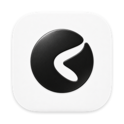
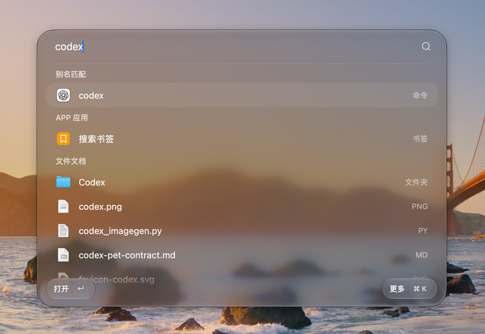

<div align="center">



# Asky

macOS 原生效率入口，连接本地搜索、剪贴板与按需 AI 助手。<br />
A native macOS launcher for local search, clipboard history, and an on-demand AI assistant.

[](project.yml)
[](Packages/KulaCore/Package.swift)
[](docs/native-tools-and-mcp.md)
[](LICENSE)

[🌐 官方网站 / Website](https://asky.niallyoung2002.workers.dev/) · [📖 使用教程 / Docs](https://asky.niallyoung2002.workers.dev/docs) · [📦 立即下载 / Releases](https://github.com/Niall-Young/Asky/releases)

[中文](#中文) | [English](#english)



</div>

---

<a id="中文"></a>
## 中文

Asky 是使用 SwiftUI 与 AppKit 构建的 macOS 原生效率入口。本地全局搜索与剪贴板历史可完全独立离线使用，AI 助手按需唤起，兼具极致轻量的系统体验与强大的扩展能力。

🌐 **官方网站**：[https://asky.niallyoung2002.workers.dev/](https://asky.niallyoung2002.workers.dev/)  
📖 **使用教程**：[功能指南与操作手册](https://asky.niallyoung2002.workers.dev/docs)

### ✨ 核心功能

- 🔍 **全局快速搜索**
  - **全能检索**：秒级检索应用程序、本地文件、Chrome 标签页与书签，以及当前运行的应用窗口（`sw`）。
  - **分类过滤与下钻**：支持 `app `（应用）、`file `（文件）、`ql `（快捷方式）、`sc `（快捷指令）专属分类过滤；选中文件夹按 `Tab` 可直接下钻浏览或检索子目录。
  - **即时计算与换算**：支持数学表达式计算、单位换算与实时汇率换算；输入 `calc` 查看计算历史并支持一键回填算式。
  - **屏幕取色器**：输入 `co` 快速调用 macOS 原生取色工具，点击即复制大写 sRGB 十六进制色值。
  - **快捷指令与终端**：集成网页搜索指令（`go`、`yt`、`x` 等预设）与终端命令执行（`> 命令`）。

- 📋 **强大的剪贴板历史**
  - **多类型支持**：完整记录文本、富文本、图片与文件历史，支持关键词与来源应用组合检索。
  - **智能颜色预览**：自动识别 `#RGB`、`rgb()`、`hsl()`、`oklch()` 等颜色代码并显示直观的圆形色盘预览。
  - **无缝粘贴体验**：`Return` 自动粘贴到目标应用（需辅助功能权限），`⌘ Return` 仅复制并保留窗口；支持文件与图片的平滑拖拽。
  - **灵活历史管理**：支持自定义保留期限（8 小时 ~ 30 天）与自动清理，支持快捷键 `⌘⌫` 单条删除或 `⌘K` 菜单清空历史。

- 🤖 **按需 AI 助手与本地记忆**
  - **轻量按需启动**：无需常驻后台 AI 进程；兼容任意 OpenAI 协议模型服务商与自定义端点。
  - **原生交互表单**：支持 AI 在对话流中渲染原生单选按钮组、下拉单选、多选、文本输入、日期及按需显示时、分、秒的时间/时长控件，填写后直接提交至同一会话。控件复用设置页组件，日期选择复用创建日程弹窗的月历。
  - **本地记忆与上下文**：基于本地 Markdown 存储用户偏好与记忆，支持长上下文智能压缩与网络实时检索。
  - **本地数学公式排版**：原生支持行内与独立 LaTeX 公式（`$…$`、`$$…$$`）排版。
  - **日程与路线规划**：集成系统 MapKit 能力，对比驾车、公交与步行耗时，自动为日程计算含缓冲时间的建议出发时间。

- 🧩 **系统生态与扩展**
  - **macOS 系统集成**：按授权安全访问系统日历、提醒事项、备忘录与通讯录。
  - **MCP 协议支持**：内置 MCP（Model Context Protocol）桥接，可无缝连接外部工具生态。
  - **可信插件体系**：支持用户主动安装 GitHub 插件；插件可提供无需 AI 的启动器命令与动态搜索结果，支持复制和打开链接，详见[插件开发](docs/plugins.md)。官方提供 [飞书插件](https://github.com/Niall-Young/asky-plugin-lark) 与 [Orca 插件](https://github.com/Niall-Young/asky-plugin-orca)。

- 🎨 **纯正 macOS 原生体验与隐私优先**
  - **现代视觉语言**：采用 AppKit 原生 Regular 玻璃与液态视觉质感，窗口平滑展开，严格适配系统“减少动态效果”。
  - **严格隐私保护**：不向作者服务器上传任何用户数据；API 密钥安全存放在 macOS 系统钥匙串中，数据完全归用户所有。详见[隐私政策](PRIVACY.md)。

---

### ⌨️ 快捷键与常用入口

| 功能 | 触发方式 / 快捷键 | 说明 |
| :--- | :--- | :--- |
| **快速搜索** | 菜单栏图标 / 自定义全局快捷键 | 键入关键词，方向键选择，`Return` 打开 |
| **剪贴板历史** | `Ctrl + Shift + C` | 浏览历史记录，`Return` 粘贴，`⌘ Return` 仅复制 |
| **新建 AI 对话** | `Ctrl + Shift + /` | 唤出按需 AI 对话界面 |
| **分类检索** | `file ` / `app ` / `ql ` / `sc ` | 仅搜索指定分类（文件/应用/快捷方式/快捷指令），`Esc` 退出 |
| **文件夹浏览** | 选中文件夹按 `Tab` | 在搜索框内直接浏览或搜索该文件夹目录内容 |
| **窗口搜索** | `sw ` 或 `sw` 后回车 | 检索当前所有运行中的应用窗口并一键切换聚焦；全屏后已发现的其他窗口仍可检索与切换；`⌘K` 菜单按窗口状态提供“进入全屏”或“退出全屏”（需目标窗口支持），“关闭窗口”固定在最下方；多屏时可用“切换到上一块屏幕 / 下一块屏幕”（`⇧ ←` / `⇧ →`），横排从左到右、竖排从上到下并循环；单屏隐藏这两项，系统全屏窗口需先退出全屏；`⌃⌘ F` 切换全屏，可在“设置 › 快捷键 › 启动器”配置 |
| **屏幕取色** | `co` 后回车 | 开启屏幕取色放大镜，点击后自动复制色值到剪贴板 |
| **计算历史** | `calc` 后回车 | 浏览最近 200 条计算结果，回车回填算式继续编辑 |
| **网页指令** | `go 关键词`、`yt 关键词` 等 | 快速调用对应搜索引擎打开浏览器 |
| **终端执行** | `> pwd` | 直接在启动器中执行 Shell 命令 |
| **项操作菜单** | `⌘K` | 打开当前项的更多操作菜单（如展示文件简介 `⌘I`、复制文件名 `⌘⇧.` 等） |
| **打开设置** | `⌘,`（窗口获焦时） | 呼出 Asky 设置面板 |

*完整快捷键配置与高级技巧见[使用教程](https://asky.niallyoung2002.workers.dev/docs)。*

---

### 📦 安装与配置

#### 下载安装
- 前往 [GitHub Releases](https://github.com/Niall-Young/Asky/releases) 或 [官方网站](https://asky.niallyoung2002.workers.dev/) 下载最新 DMG 安装包（支持 macOS 15+，Apple Silicon）。
- 打开 DMG，将 `Asky.app` 拖入“应用程序”目录即可。安装包已预置 Node.js 与 AgentRuntime，无需手动配置外部环境。
- 应用默认开启静默自动更新，可在“设置 › 关于 Asky › 软件更新”中管理。

#### 权限与 AI 配置
- **系统权限**：自动粘贴与窗口搜索功能需要 macOS **辅助功能**（Accessibility）权限；访问日历、备忘录等需在首次使用时授权。
- **智能配置**：在“设置 › 智能配置”中填入对应模型服务商的 API Key，或自定义兼容 OpenAI 协议的 Base URL 及模型名。API 密钥安全存放在 macOS 系统钥匙串中。

---

### 🛠️ 开发与构建

#### 环境要求
- macOS 15+ (Apple Silicon)
- Xcode 16+ / Swift 6.2+
- Node.js 22+
- [XcodeGen](https://github.com/yonaskolb/XcodeGen) (`brew install xcodegen`)

#### 构建与运行
在仓库根目录执行：

```sh
# 1. 安装 Agent 运行时依赖并构建
(cd AgentRuntime && npm ci && npm run build)

# 2. 生成 Xcode 工程
xcodegen generate

# 3. 编译并启动 Debug 版本
DEVELOPER_DIR=/Applications/Xcode.app/Contents/Developer xcodebuild -project Asky.xcodeproj -scheme Asky -configuration Debug -derivedDataPath build/DerivedData build
open build/DerivedData/Build/Products/Debug/Asky.app
```

#### 运行测试
```sh
# 核心测试套件
(cd AgentRuntime && npm test)
python3 App/Tests/run-launcher-window-regression.py --window-search-spaces
(cd MCPBridge && DEVELOPER_DIR=/Applications/Xcode.app/Contents/Developer swift build)
(cd Packages/KulaCore && DEVELOPER_DIR=/Applications/Xcode.app/Contents/Developer swift test)
```

> [!NOTE]
> 完整的 UI 自动化回归脚本、Debug 交互预览参数以及 Developer ID 签名与公证打包流程，详见[开发与发布指南](docs/development.md)。

---

### 📂 代码结构与文档

| 目录 | 职责说明 |
| :--- | :--- |
| `App/` | 基于 SwiftUI 与 AppKit 的原生客户端界面与交互实现 |
| `Packages/KulaCore/` | 核心业务模型与统一系统访问入口 `ToolService` |
| `AgentRuntime/` | 基于 TypeScript 构建的轻量 AI 运行时宿主 |
| `MCPBridge/` | Model Context Protocol 原生桥接服务 |

- [文档索引](docs/README.md) · [产品需求 (PRD)](docs/PRD.md) · [系统架构](docs/framework.md) · [设计规范](docs/design-system.md) · [插件开发](docs/plugins.md) · [隐私政策](PRIVACY.md)

---

### 📄 许可证

本项目采用 [MIT 许可证](LICENSE)。第三方依赖项遵循其各自的开源协议。

[English](#english) · [返回顶部](#asky)

---

<a id="english"></a>
## English

Asky is a native macOS efficiency launcher built with SwiftUI and AppKit. Local global search and clipboard history work completely offline without relying on AI, while the AI assistant runs on-demand—delivering both lightweight performance and extensive expandability.

🌐 **Website**: [https://asky.niallyoung2002.workers.dev/](https://asky.niallyoung2002.workers.dev/)  
📖 **Documentation**: [User Guide & Manual](https://asky.niallyoung2002.workers.dev/docs)

### ✨ Key Features

- 🔍 **Global Fast Search**
  - **Comprehensive Retrieval**: Instantly search applications, local files, Chrome tabs and bookmarks, and active application windows (`sw`).
  - **Category Filtering & Deep Dive**: Use dedicated filters like `app `, `file `, `ql ` (quick links), and `sc ` (shortcuts). Press `Tab` on any folder to browse or search its subdirectories directly.
  - **Instant Calculations & Conversions**: Support for mathematical formulas, unit conversions, and live currency rates. Enter `calc` to view calculation history and restore expressions with one click.
  - **Screen Color Picker**: Enter `co` to launch macOS's native color sampler; click to copy the sRGB uppercase hex value.
  - **Web Commands & Terminal**: Quick web search presets (`go`, `yt`, `x`, etc.) and terminal command execution (`> command`).

- 📋 **Robust Clipboard History**
  - **Multi-Type Support**: Records text, rich text, images, and files with combined keyword and source app search.
  - **Smart Color Previews**: Automatically detects `#RGB`, `rgb()`, `hsl()`, `oklch()`, and other CSS color formats, rendering circular color previews.
  - **Seamless Pasting**: Press `Return` to paste into the active target app (requires Accessibility permission); `⌘ Return` copies while keeping the panel open. Supports smooth drag-and-drop for files and images.
  - **Flexible Retention**: Configure history retention (8 hours to 30 days) with automatic cleanup. Delete single entries with `⌘⌫` or clear all via the More menu (`⌘K`).

- 🤖 **On-Demand AI Assistant & Local Memory**
  - **On-Demand Lifecycle**: Keeps background resource usage minimal; connects to any OpenAI-compatible provider and custom endpoints.
  - **Native Interactive Forms**: AI can stream structured form controls (text fields, native radio groups, dropdowns, checkboxes, date pickers and configurable hour/minute/second time or duration controls) directly in chat, which submit straight back into the conversation. Controls reuse the Settings components; date selection uses the calendar from the event creation dialog.
  - **Local Memory & Context**: Stores user preferences and context in local Markdown files with automatic context compaction and web search.
  - **Native LaTeX Rendering**: Renders inline and block LaTeX formulas (`$…$`, `$$…$$`) locally.
  - **Smart Travel & Calendar Planning**: Built-in MapKit support to compare driving, transit, and walking times, suggesting arrival-buffered departure times for your day.

- 🧩 **System Integration & Extensibility**
  - **macOS Native Access**: Authorized access to system Calendars, Reminders, Notes, and Contacts.
  - **MCP Protocol**: Built-in Model Context Protocol bridge for broad compatibility with external tooling ecosystems.
  - **Trusted Plugin System**: Install plugins from GitHub on demand. Plugins can provide launcher commands and dynamic search results without AI, with copy and open-link actions; see the [plugin guide](docs/plugins.md). Official integrations include [Feishu](https://github.com/Niall-Young/asky-plugin-lark) and [Orca](https://github.com/Niall-Young/asky-plugin-orca).

- 🎨 **Pure macOS Native Experience & Privacy First**
  - **Modern Interface**: Engineered with AppKit Regular Liquid Glass, smooth window transitions, and full support for Reduce Motion.
  - **Privacy First**: Zero telemetry sent to author servers. Sensitive credentials and API keys are stored securely in the macOS Keychain. See [Privacy Policy](PRIVACY.md).

---

### ⌨️ Shortcuts & Key Entries

| Feature | Trigger / Shortcut | Description |
| :--- | :--- | :--- |
| **Quick Search** | Menu bar icon / Global hotkey | Type keywords, navigate with arrow keys, press `Return` to open |
| **Clipboard History** | `Ctrl + Shift + C` | Browse history, `Return` to paste, `⌘ Return` to copy |
| **New AI Chat** | `Ctrl + Shift + /` | Open the on-demand AI conversation panel |
| **Category Search** | `file ` / `app ` / `ql ` / `sc ` | Filter results by category (files/apps/quick links/shortcuts); `Esc` to exit |
| **Folder Browse** | Select folder + `Tab` | Browse or search folder contents directly in launcher |
| **Window Search** | `sw ` or `sw` + Return | Find and focus running application windows; previously discovered windows remain searchable and switchable after another window enters full screen; `⌘K` offers Enter Full Screen or Exit Full Screen for supported windows, with Close Window always last; with multiple displays, Move to Previous/Next Display (`⇧ ←` / `⇧ →`) cycles left to right for horizontal layouts and top to bottom for vertical layouts; both actions are hidden with a single display, and native full-screen windows must exit full screen before moving; `⌃⌘ F` toggles full screen and is configurable in Settings › Shortcuts › Launcher |
| **Color Picker** | `co` + Return | Open screen color sampler and copy hex value to clipboard |
| **Calculation History** | `calc` + Return | View last 200 calculations and restore expressions |
| **Web Commands** | `go keyword`, `yt keyword`, etc. | Search directly on target websites in your browser |
| **Terminal** | `> pwd` | Execute shell commands directly from the search bar |
| **Action Menu** | `⌘K` | Open context menu (Show Get Info `⌘I`, Copy filename `⌘⇧.`, etc.) |
| **Settings** | `⌘,` (when window is focused) | Open Asky Settings |

*See the [User Guide](https://asky.niallyoung2002.workers.dev/docs) for advanced configuration and full shortcut listings.*

---

### 📦 Installation & Setup

#### Download & Install
- Download the latest DMG release from [GitHub Releases](https://github.com/Niall-Young/Asky/releases) or the [Official Website](https://asky.niallyoung2002.workers.dev/) (macOS 15+, Apple Silicon).
- Open the DMG and drag `Asky.app` into Applications. Node.js and AgentRuntime are bundled—no extra setup required.
- In-app automatic updates are enabled by default; configure in Settings › About Asky › Software Update.

#### Permissions & AI Configuration
- **Permissions**: Automatic pasting and window search require macOS **Accessibility** access. Calendar and Notes access require user authorization on first use.
- **Model Setup**: Go to Settings › Model Settings to configure your API Key or custom OpenAI-compatible endpoint. Keys are stored safely in the macOS Keychain.

---

### 🛠️ Development & Building

#### Prerequisites
- macOS 15+ (Apple Silicon)
- Xcode 16+ / Swift 6.2+
- Node.js 22+
- [XcodeGen](https://github.com/yonaskolb/XcodeGen) (`brew install xcodegen`)

#### Build & Run
Run from the repository root:

```sh
# 1. Install AgentRuntime dependencies and build
(cd AgentRuntime && npm ci && npm run build)

# 2. Generate Xcode project
xcodegen generate

# 3. Build and launch Debug app
DEVELOPER_DIR=/Applications/Xcode.app/Contents/Developer xcodebuild -project Asky.xcodeproj -scheme Asky -configuration Debug -derivedDataPath build/DerivedData build
open build/DerivedData/Build/Products/Debug/Asky.app
```

#### Running Tests
```sh
# Core test suites
(cd AgentRuntime && npm test)
python3 App/Tests/run-launcher-window-regression.py --window-search-spaces
(cd MCPBridge && DEVELOPER_DIR=/Applications/Xcode.app/Contents/Developer swift build)
(cd Packages/KulaCore && DEVELOPER_DIR=/Applications/Xcode.app/Contents/Developer swift test)
```

> [!NOTE]
> For UI automation regression scripts, Debug interactive preview arguments, and Developer ID code-signing and packaging, see the [Development and Release Guide](docs/development.md).

---

### 📂 Codebase & Docs

| Directory | Responsibility |
| :--- | :--- |
| `App/` | Native macOS user interface and interactions (SwiftUI & AppKit) |
| `Packages/KulaCore/` | Core business logic and unified system access through `ToolService` |
| `AgentRuntime/` | TypeScript-based lightweight AI host runtime |
| `MCPBridge/` | Native Model Context Protocol bridge |

- [Docs Index](docs/README.md) · [Product Requirements (PRD)](docs/PRD.md) · [Architecture](docs/framework.md) · [Design System](docs/design-system.md) · [Plugins](docs/plugins.md) · [Privacy](PRIVACY.md)

---

### 📄 License

Distributed under the [MIT License](LICENSE). Third-party dependencies retain their respective licenses.

[中文](#中文) · [Back to top](#asky)
