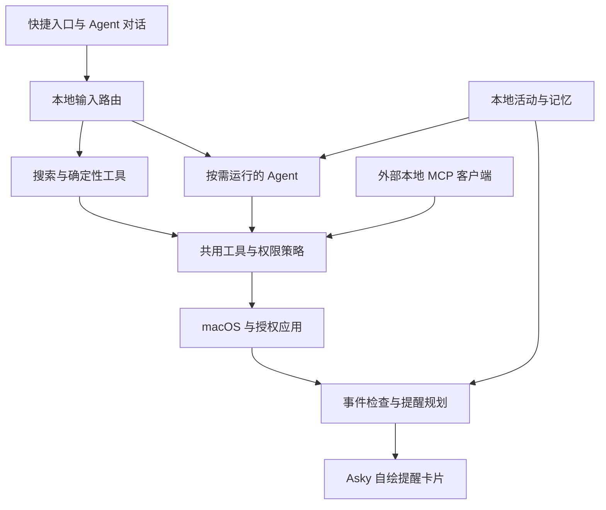

# Asky V1 产品需求文档

版本：0.2。更新日期：2026 年 10 月 9 日。

状态：需求草案，功能尚未实现。交付目标：完整自用版，分阶段实现。

需求来源：[SwiftUI Agent构想](https://chatgpt.com/c/6ac7944a-fc58-83e8-ab44-cac56c1dd796)，以及 2026 年 10 月 9 日确认的首版取舍与本轮架构讨论。

本稿中的“已确认要求”表示必须满足的产品行为，不表示已经实现；“建议默认值”为可校准的设计初值；“待原型验证”须完成 M0 或对应阶段验证后锁定。专题与权威内容见[文档索引](README.md)。

Asky 是一个使用 SwiftUI 与 AppKit 构建的 macOS 原生效率入口。用户通过快捷键完成搜索、启动应用和执行命令；需要理解复杂意图时，入口展开为 AI 对话；应用在日常使用中积累本地记忆，并根据已获授权的事件提供少量有依据的提醒。

首版面向开发者本人日常使用，以“可以稳定替代现有工具中的高频入口，并通过记忆减少重复解释”为成功标准。专业应用继续承担各自的工作，Asky 负责理解意图、调用能力和连接上下文。

## 产品框架

### 三层能力

| 层级 | 用户价值 | V1 能力 |
| --- | --- | --- |
| 桌面效率入口 | 快速找到并执行日常操作 | 应用、文件、Chrome 标签页搜索；关键词搜索；终端命令；快捷指令；计算、换算和汇率；剪贴板历史 |
| AI 能力增强 | 用自然语言连接系统工具 | 多轮对话、截图理解、日程与提醒事项操作、备忘录整理、联系人查找、授权短信查询与草稿交接 |
| 个人上下文增强 | 减少重复解释，在需要准备时获得帮助 | 本地记忆提炼与检索、偏好更新、日程冲突识别、出行准备和重要日期提醒 |

### 两个主要界面

**快捷入口**默认呈现单行输入与结果列表。用户可以全程使用键盘完成搜索、选择和执行，任务完成后窗口收起。

**Agent 对话**是同一入口的展开形态，承担提问、多轮任务、附件理解和执行反馈。用户可以直接进入对话，也可以从输入框中的自然语言任务进入。

设置、历史对话与记忆管理是辅助页面。记忆引擎、后台事件监听和提醒规划不形成独立工作台。

### 已确认的版本边界

| 决策 | V1 范围 |
| --- | --- |
| 交付对象 | 完整自用版，先通过个人日常工作流验证 |
| 浏览器 | 搜索 Chrome 已打开标签页与本地书签；网址使用默认浏览器打开，不采集浏览历史 |
| 剪贴板 | 历史检索与复用，不包含独立网页剪报收藏系统 |
| 记忆来源 | 当前自动提炼仅处理 Asky 内已允许的对话；也支持明确要求保存 |
| 模型 | 用户自带 API Key；OpenAI-compatible Chat Completions 优先，图像与工具能力分别检查；必要上下文按授权外发 |
| Agent | Pi SDK 为优先验证方案，以可替换本地辅助进程集成；仅加载所需扩展 |
| 常驻方式 | 原生入口常驻；配置模型、打开 AI 页面或看历史不启动 Agent；明确 AI 请求才启动 |
| 界面 | SwiftUI 与 AppKit 原生控件，使用用户 Figma 变量与 Styles，加入系统 Liquid Glass |
| MCP | 提供独立本地 MCP，Asky 与外部 AI 客户端共用系统工具 |
| 短信 | 开启 AI 短信读取并授予完全磁盘访问后，按关键词查询本机最近 3/7/30 天（用户选择，默认 3 天）的信息；组织可编辑草稿，由用户检查并发送 |

V1 不包含独立翻译器、录屏器、笔记编辑器、浏览器行为追踪、大型插件商店、多 Agent 协作、无人值守长期任务、账号与计费、跨设备记忆同步。用户主动询问翻译时可以获得 AI 回答，但不建设一套划词翻译产品。

## 功能需求

### 快捷入口与输入路由

默认快捷键建议为 `⌥ Space`，允许更改并检测占用。通过菜单栏也可以唤起入口。窗口出现后直接聚焦输入框，适配多显示器、浅色与深色外观，并支持系统辅助功能与减少动态效果设置。

输入先经过本地关键词、表达式和搜索规则处理。输入应用名、计算式或已配置命令时，不调用大模型。AI 仅在用户提交问题或任务后运行，不能随每次输入发送请求。

| 输入 | 处理方式 | 预期结果 |
| --- | --- | --- |
| `Chrome` | 本地应用搜索 | 启动或切换至 Chrome |
| 文件名或片段 | 本地文件搜索 | 展示匹配文件，支持打开与在 Finder 显示 |
| 标签页标题或 URL 片段 | Chrome 标签页搜索 | 切换至对应窗口和标签页 |
| `go SwiftUI` | 关键词命令 | 使用浏览器打开 Google 搜索结果 |
| `> pwd` | 显式终端命令 | 打开所选终端（默认系统终端），在选定工作目录执行 |
| `128 * 0.85` | 本地计算 | 即时展示结果并允许复制 |
| `100 USD CNY` | 汇率换算 | 横向展示输入币种、金额与换算结果 |
| `帮我安排明天下午的工作` | 提交自然语言任务 | 展开 Agent 对话 |

普通入口未输入显式关键词、且没有实际本地匹配结果的纯文字（例如“你是谁啊”“你好”）只显示并默认选中“询问 AI”，回车展开对话；通用书签搜索入口和 Google 搜索动作不视为实际命中。明确的自然语言请求继续直接显示 AI，输入期间不调用模型。应用名、文件片段仍走本地搜索，显式关键词和书签搜索模式优先。AI 条目只显示标题，不展示提交快捷键副标题。普通搜索同时保留“询问 AI”动作，`⌘ Return` 可明确提交给 AI。`Return` 执行当前选中结果，方向键移动选择；`Escape` 先退出子视图，再隐藏窗口。输入歧义不能造成隐式执行终端命令或系统写入。

### 原生界面与设计来源

设计来源为[Asky Figma，node 6:12](https://www.figma.com/design/tmVnTyCb2sz5egNQ7We9Sw/KulaHere?node-id=6-12)。当前目标是空页面，提供的文件级变量与文字 Styles 用于样式映射，不视为完整屏幕或组件规范。

使用 SwiftUI / AppKit 原生组件，保留输入法、键盘、焦点与辅助功能行为。浮动入口、导航与操作区域使用原生 Liquid Glass；正文与结果保持清晰阅读层，适配浅深色、不同壁纸、减少透明度与减少动态效果。变量完整表、文字角色、窗口尺寸和原生映射见[设计系统](design-system.md)。窗口几何为原型默认值。

### 搜索与确定性工具

- **分类搜索**：普通搜索按每个来源最多 8 条返回快速候选；通过 `file `、`app `、`ql `、`sc ` 指令进入文件、应用、快捷方式或快捷指令模式后，保留输入词，仅查询该分类，最多返回 200 条并支持列表滚动与键盘选择。退出模式返回普通搜索后恢复快速候选数量；切换分类后的迟到结果不可覆盖当前分类。200 条为结果上限，不承诺列出全部命中。分类模式在输入框显示对应图标；Esc 返回普通搜索并保留查询，空输入退格退出。四条分类指令可在“设置 › 指令”修改、保存和恢复默认，支持输入触发词或搜索指令名称后选中回车进入空查询模式。搜索模式互斥，分类内的指令样式文本作为普通查询，不叠加或切换到其他模式；需先退出再进入另一模式。启动器不提供固定按钮、筛选按钮或来源筛选菜单；搜索框右侧常驻装饰性搜索图标，没有点击或悬停交互，失焦正常隐藏窗口。
- **应用搜索**：匹配名称与别名，优先显示常用和最近使用应用，支持启动及切换。
- **文件搜索**：复用 Spotlight 的文件元数据，首版搜索文件名与路径；用户配置搜索范围和排除目录。不建设全盘文档内容检索系统。选中文件夹按 `Tab` 进入目录内搜索，输入框显示文件夹图标与名称；空输入列出直属可见项目，输入文件名后搜索当前目录及 Spotlight 已索引的子目录，保留排除目录规则。子文件夹可继续按 `Tab` 进入；空输入退格默认返回上一层，可在“设置 › 搜索与导航”选择“退出文件夹导航”，一次清空全部文件夹层级与查询。`Escape` 始终返回上一层；逐层退出最外层时恢复原搜索。应用包不作为可进入目录，回车仍打开当前选中项。Spotlight 提供文件元数据查询能力。[Apple Spotlight 文档](https://developer.apple.com/documentation/foundation/spotlight)
- **应用窗口**：`sw` 回车或 `sw 空格` 进入窗口搜索，空查询列出各应用通过辅助功能暴露的窗口；按窗口标题和应用名匹配，同一应用多个窗口（包括同标题窗口）分别列出。选择后校验窗口身份并切换到该窗口，最小化窗口先恢复；已关闭目标不能回退到同应用其他窗口。需要辅助功能权限，不支持不暴露窗口信息的应用；列表仅在当前面板保留，重新进入刷新。触发词在“设置 › 指令”修改，Esc 返回普通搜索并保留查询，空查询退格退出。
- **Chrome 标签页**：在“设置 › 指令”提供“搜索开启的标签页”，默认触发词为 `st`，支持修改、保存与恢复默认；输入 `st 空格` 进入仅检索已开启 Chrome 标签页的模式，输入框与结果使用用户提供的紫色窗口 Logo。空输入时按退格或 Esc 退出模式。检索标题与 URL，区分同名标签所在窗口；执行前校验目标仍然存在。排除无痕窗口，缓存仅用于当前搜索，不自动转为浏览记忆。
- **链接与书签**：网址或域名输入显示链接结果；单个英文单词（如 `happy`）只在匹配已知站点时生成链接：Chrome 书签或已缓存标签页中，去掉 `www.` 后主机名以该词开头的站点（取最短主机名），链接到该站点根地址（如 `https://www.happyoyster.com`）；无匹配（如 `kidfasl`）不生成链接，只显示默认搜索。链接显示在应用结果之后。默认搜索不检索书签，只显示「搜索书签」入口；选择入口或输入 `bm ` 进入书签搜索（输入框显示书签图标，退格或 Esc 退出），此时只检索 Chrome 本地书签（含登录同步的 AccountBookmarks），按标题和 URL 匹配，支持文件夹中的书签。`bm` 是默认书签指令，可在“设置 › 指令”中修改；同页配置链接搜索（默认 `link 空格`，输入网址或域名）与 AI 搜索（默认 `ai 空格`，回车提交前不调用模型）。链接与书签使用已有系统图标，选择后以默认浏览器打开；书签遵循 Chrome 数据源开关，不读取浏览历史。
- **关键词搜索**：`go`（Google 搜索）、`chat`（ChatGPT）、`ds`（DeepSeek）、`yt`（YouTube）、`dy`（抖音）、`tb`（淘宝）、`jd`（京东）、`bl`（bilibili）、`gh`（GitHub）、`bd`（百度）、`hb`（花瓣）、`zh`（知乎）、`xhs`（小红书）、`wb`（微博）、`x`（X / Twitter）和 `>`（终端）为内置指令，在“设置 › 指令”中展示，列表顶部支持按指令缩写与名称即时搜索（不区分大小写），提供清除搜索与无匹配提示；每条网页指令左侧提供启用复选框，默认仅开启 `go`、`chat`、`dy`、`tb`、`jd`、`bl`、`gh`、`x`，其余默认关闭；新配置及缺少启停字段的旧配置使用此默认值，已有启停配置保留；取消后不再匹配或显示对应搜索候选，重启后保留；提供触发词修改、保存和恢复默认，不提供新增或删除预设；触发词不能为空、包含空白或与现有指令及别名重名。搜索指令 `sw`、`st`、`bm`、`link`、`ai`、`file`、`app`、`ql`、`sc`（含用户自定义触发词）在普通搜索中精确匹配时，显示对应 Logo 与名称并置顶，回车进入空查询的对应模式；输入触发词后按空格同样进入模式，进入 AI 模式不调用模型。启动器不读取旧的网页关键词配置；`go 搜索内容` 自动处理参数编码，`chat 问题` 自动向 ChatGPT 传递问题，`ds 问题` 通过 `https://chat.deepseek.com/?q={query}` 填入 DeepSeek 输入框后手动发送，两者不需要调用 Asky 的 AI。DeepSeek 使用随应用打包的官方蓝色鲸鱼 Logo，设置、搜索结果与输入模式保持一致。
- **终端命令**：输入英文 `>` 后按空格进入终端输入模式；单独的 `>` 或 `>pwd` 保持普通搜索。进入模式后，回车将命令交给设置中选择的终端（默认 macOS「终端」），在配置的工作目录执行；输出、退出状态与停止由终端应用管理。在“设置 › 指令 › 终端”选择执行命令的终端，支持已安装的系统终端、iTerm2、Ghostty 1.3+；入口和结果显示该终端应用的真实图标。已配置终端被卸载时提示重新选择。空输入不执行，输入框为空时按退格退出模式；AI 提议的命令先展示给用户，不能直接套用为已授权命令。
- **快捷指令**：列出并运行 macOS Shortcuts，展示开始、完成或失败状态，参数缺失时请求补充。
- **计算与换算**：支持常用算术、长度、质量、温度和容量换算；解析失败时回到搜索，不执行代码。`calc` 或“计算历史”入口展示最近 200 条本地计算记录，确认复制计算结果时保存；左侧复制结果，更多菜单提供“基于此继续计算”（退出历史并将原算式填回搜索框）与 negative 色的“删除记录”。
- **汇率**：首版建议使用 ECB 日参考汇率，在本地完成交叉换算；横向双卡片展示输入币种、金额与目标币种的换算值；外币默认换算人民币，人民币默认换算美元，显式币种对按输入计算，其他币种保持列表位于卡片下方，不提供复制、选中或悬停操作。来源、日期与缓存状态保留在数据层。ECB 提供日参考汇率及可下载数据，因此首版定位为日参考换算，不承诺实时交易报价。[ECB 参考汇率](https://www.ecb.europa.eu/stats/policy_and_exchange_rates/euro_reference_exchange_rates/html/index.en.html)

### 剪贴板历史

用户启用后记录文字、图片与文件，按文字或文件名检索，图片显示缩略图；文件记录保留整组原路径，可重新复制及拖出真实文件，原件丢失、不可读或图片损坏时从历史列表与搜索结果中隐藏，原路径恢复可用后重新显示；移动原文件后需重新复制，删除历史不删除原文件；支持重新复制、删除单项与清空历史；不再提供记录固定入口或快捷键，已有固定记录的数据与保留策略兼容旧版本。粘贴到前台应用需要独立授权；未获得授权时提供复制动作。

提供暂停记录、排除应用与保留期限设置。遵守来源应用提供的敏感或临时剪贴板标记，并默认排除密码管理器；这些措施不代表能够识别所有敏感内容。剪贴板历史与长期记忆分开，复制内容不会自动全部进入记忆或发送给模型。

### AI 对话与当前上下文

支持流式回答、多轮对话、历史恢复、停止生成和重新提交。模型配置包含 API 地址、模型名与 API Key；首版优先 OpenAI-compatible Chat Completions。连接检查分别验证对话、图像输入和工具调用能力。某项能力缺失时，禁用对应入口并说明原因。

原生应用启动后默认不启动 Pi。打开 AI 界面与查看历史只使用原生分页数据；明确提交 AI 请求才启动辅助进程，并立即显示启动状态。连续对话可复用当前进程；无活动任务、工具或操作确认时，默认空闲 60 秒保存会话并真正退出进程，下次提交恢复必要上下文。等待普通补充输入可保存后按空闲规则退出。隐藏窗口不取消任务。

Agent 仅加载明确允许的扩展与工具，不自动读取用户全局 Pi 配置或无关资源。系统操作通过原生 ToolService；不开放默认编码工具或内置自由 Shell 入口。用户可主动安装可信 GitHub 插件，官方插件独立仓库发布且不进入安装包；插件声明的 CLI 操作经 ToolService 执行，不提供沙箱，详见[插件指南](plugins.md)。Pi 依赖、冷启动与会话恢复必须经原型验证，不能把选装扩展描述为消除全部 Runtime 依赖。详见[Agent Runtime](agent-runtime.md)。

用户可以粘贴文本、拖入图片或主动选择截图作为当前任务附件。截图用于单次理解，不持续捕获屏幕。选中文字通过显式“使用当前选择”动作获取；没有权限时允许复制后粘贴。

对话中展示正在使用的工具、待补充信息、待确认操作和最终结果。隐藏窗口不等于停止任务，用户通过“停止”明确取消。取消不能撤销已经完成的系统写入，结果中必须区分已完成与未执行步骤。

### 系统应用操作

日程、提醒事项、备忘录、通讯录与短信只接入 macOS 苹果官方应用和系统接口，不引入第三方替代工具。苹果日历内的日历名称与账户名称不代表应用名称；结果需明确展示应用和实际所属日历，不能把例如「大麦」的日历名称描述成第三方应用。

| 数据源 | V1 操作 | 交互要求 |
| --- | --- | --- |
| 日历 | 查询、创建、修改和删除事件，检查时间冲突 | 明确要求且信息完整的新建可以直接执行；修改既有安排、删除及批量操作先展示变更 |
| 提醒事项 | 查询、创建、修改、完成与删除 | 展示所属清单、截止时间和最终状态；删除或批量修改需确认 |
| 备忘录 | 在授权账户与文件夹中搜索、读取、新建和追加文本 | 不默认扫描所有备忘录；修改既有内容先展示目标与追加内容；不支持附件编辑、锁定内容和删除 |
| 联系人 | 按姓名或已确认关系查找联系方式 | 同名、多号码或“奶奶”等关系不明确时，由用户选择，不推测收件人 |
| Messages | 按关键词和日期查询最近 30 天的短信与 iMessage；组织草稿并交接 | 读取默认关闭，需明确启用与完全磁盘访问；过滤验证码、遮盖长数字，必要查询结果发送到配置的模型服务；不向外部 MCP 提供历史查询，最终发送由用户完成 |

日历与提醒事项使用 EventKit，联系人使用 Contacts。操作前检查系统授权，拒绝授权只影响对应能力。[Apple EventKit 授权](https://developer.apple.com/documentation/eventkit/ekeventstore/requestfullaccesstoreminders(completion:)), [Apple 联系人授权](https://developer.apple.com/documentation/contacts/accessing-the-contact-store)

备忘录和 Chrome 使用各自支持的自动化接口。Apple Events 访问需要用途声明和用户授权，MCP 不代替系统权限。[Apple 自动化权限](https://developer.apple.com/documentation/bundleresources/information-property-list/nsappleeventsusagedescription)

Messages 交接优先填入收件人和草稿；目标系统无法可靠预填正文时，复制草稿并打开 Messages，明确提示用户粘贴。界面只能报告“草稿已准备”或“已交接”，不能报告“已发送”。

### 本地记忆

记忆用于减少用户重复说明，当前采用本机 Markdown 索引加主题文件：`MEMORY.md` 保存稳定事实、通用偏好与主题入口，较长的长期项目细节放入主题文件，AI 按需读取。活动与完整对话继续独立保存，不等同于长期记忆。

用户可在对话中明确要求保存、纠正或忘记，也可从“设置 › 智能配置 › 记忆文件”进入访达编辑。设置页只提供开关与文件入口；不再提供逐条确认、固定或“保存为纠正”列表。当前文件方案不保存逐条来源元数据或替代关系。

自动提炼只从已允许的应用内对话中保留用户明确表达的稳定事实、长期偏好、持续数周以上的项目。一次性任务、临时日程与待办、工具过程、第三方资料及助理推测不应写入。对话空闲至少 30 分钟后，在后续 AI 使用机会分批处理；无需开启情境提醒的后台 AI 判断。

记忆有变化或索引过长时自动整理，尝试至少间隔 6 小时。整理合并重复、更新新旧说法、清除明显过时或临时内容并分配主题文件，保留最近一次整理前的 `.previous/` 副本。提炼与整理使用用户配置的模型服务，不代表离线推理。

关闭“开启记忆”暂停自动提炼和整理；关闭“个人记忆”数据来源停用上下文和记忆工具。关闭开关不会删除文件，删除对话不会自动删除已有记忆，忘记一行也不会同步删除旧整理副本。来源删除联动、防止重新生成和完整擦除仍属待验收要求，不应当作当前能力承诺。详细规则见[数据、记忆与提醒](data-and-memory.md)。

### 情境提醒

首版只提供三个明确场景，用户按类别启用。事件变化、时间接近、相关记忆更新和系统恢复触发本地检查，不定时让模型扫描整个系统。

后台模型唤醒默认关闭。本地时间冲突、确定性的路线检查和已安排通知照常运行；需要模型理解的新复杂建议与记忆提炼候选进入有界队列，下次明确使用 AI 时处理。用户可以单独启用后台 AI，但仍只处理授权范围内的有效候选。默认策略下，依赖模型的新建议可能延后，不能承诺所有智能提醒实时生成。

| 场景 | 触发与依据 | 用户得到什么 |
| --- | --- | --- |
| 日程冲突 | 授权日程时间重叠，或相邻地点的路线耗时超过可用间隔 | 冲突说明、涉及的日程与可选处理，不自动改动日程 |
| 出行准备 | 起终点、时间及交通偏好明确，且取得有效路线估计 | 建议出发时间、路线依据与查看地图入口 |
| 重要日期准备 | 日历事件与相关记忆显示可能需要提前准备 | 提前准备建议，如生日礼物或已讨论的会前资料 |

生日默认提前 7 天进行准备检查。是否建议送礼取决于已确认关系或此前表达的送礼意图，不能仅因出现生日就认定需要购买。缺少快递时效信息时，不给出确定到货承诺。

出行建议优先采用已确认的交通偏好。没有起点、地点不明确或路线请求失败时，只提供检查路线的建议，不生成具体出发时间。路线计算会向地图服务发送必要地点，需单独说明并启用；首版不后台持续采集位置。

用户另行开启后台 AI 与短信读取并完成授权后，可从短信/iMessage 中识别明确的会议、预约或出行，并在自绘卡片中提供“创建日程”。点击后在 Asky 内打开参考系统日历详情的紧凑分组弹窗，支持修改标题、起止时间、地点、可写目标日历和备注；创建前显示系统默认日历并允许切换。确认后通过 ToolService 保存并回读，不启动日历应用。缺少结束时间时按 1 小时预填，不额外展示提示文案。取消不写入；冲突或失败保留已填写内容，允许修改重试。无效、过期或已存在的相同安排不建议重复创建；未知写入结果复用原请求核实，不盲目新建。

提醒提供“稍后提醒”“已处理”和“关闭此类提醒”。能直接处理的提醒，主操作写成要做的事，如会议提醒用“打开日程”、出行提醒用“查看路线”。卡片顶部不显示应用名称和提醒原因信息按钮。卡片中文文案结尾不使用句号，保留句中标点。同一事件和原因去重，事件变更后取消过期计划。智能建议默认每天最多 2 条，并建议使用本地时间 09:00 至 21:00 的提醒窗口；用户明确设置的定时提醒不受建议数量限制。

提醒使用 Asky 自绘的右上角卡片，显示当前应用图标，默认无声且不抢焦点，不申请系统通知权限、不进入通知中心。顶部仅保留应用图标、提醒类别（如有）和时间，不显示应用名称及提醒原因信息按钮。仅在应用运行时投递；退出后不弹出提醒，恢复运行或唤醒时重新校验计划。自绘卡片不由系统通知或专注模式管理。

## 核心用户流程

### 搜索并返回原工作

用户按快捷键，输入应用名、文件名或 Chrome 标签页关键词，使用方向键选择并按回车。应用打开目标并收起入口。整个过程不依赖模型配置，不等待 AI Runtime 或网络。

### 用一句话创建日程

用户输入“明天下午三点和小王讨论 Asky，持续一小时”。Agent 明确日期、时间与时长，查询冲突后创建事件并展示结果。若已有重叠日程，则展示冲突并让用户决定；不能自行挪动其他安排。缺少必要时间信息时只补问缺失项。

### 给奶奶准备短信

用户说“给奶奶发个短信，说我周末来看她”。Agent 使用已确认的联系人关系，或让用户选择对象，生成可编辑草稿。用户点击交接后在 Messages 检查收件人与正文，并手动发送。应用不会把交接视为发送完成。

### 找回项目上下文并写入备忘录

用户说“把上次聊的 App 想法整理到备忘录”。Agent 检索本地情景记忆与来源对话；存在多个项目时让用户选择。展示整理结果和写入位置，按用户意图新建或经确认追加，完成后返回备忘录引用。没有匹配记录时明确说明，不编造过去的讨论。

### 在需要准备时安静提醒

用户日历包含一周后的生日，此前讨论过送礼。应用根据事件和记忆生成准备计划，到时间显示无声提醒；用户可以稍后处理或关闭。新增已完成准备的记录后，应用取消不再需要的提醒。

## 架构与数据边界

完整框架与接口职责见[产品框架与架构大纲](framework.md)。Pi、原生工具、数据、设计与性能的详细约束分别在[文档索引](README.md)中的专题维护。

Launcher、Agent 和外部 MCP 共用系统工具实现及权限策略。原生操作不必经过 MCP 序列化；MCP 作为对外协议桥接层，不能成为快捷入口的启动依赖。Agent 的网络请求、工具等待和记忆提炼不能阻塞输入与本地结果。

本地存储采用 SQLite 管理活动、工具执行记录、提醒计划及对话的产品显示与检索；个人记忆采用 Markdown 索引与主题文件。Pi 会话与原生对话投影的唯一权威、同步恢复及附件清理须经 M0 验证，不建立两份互相独立的完整对话事实来源。完整历史落盘，不全部常驻内存。API Key 存入 Keychain，不能写入普通配置、日志或导出文件。Keychain 用于存储密码与密钥等小型敏感数据。[Apple Keychain 文档](https://developer.apple.com/library/archive/documentation/Security/Conceptual/cryptoservices/KeyManagementAPIs/KeyManagementAPIs.html)

云端请求仅包含当前任务、必要的对话片段、检索记忆和工具结果。设置分别控制“允许该来源用于 AI”与“允许提炼记忆”；提供来源排除、暂停采集、删除与本地导出。自动提炼涉及云端模型时也必须服从该来源的 AI 授权，来源限制继承至摘要与派生记忆，不能通过提炼绕过禁止外发。界面准确说明哪些数据可能发往用户配置的模型，不把本地存储描述成完全离线推理。

### MCP 接口边界

V1 提供基于 stdio 的本地 MCP 入口，支持日历、提醒事项、备忘录、联系人、Chrome 标签页和 Messages 草稿交接工具。原计划采用官方 Swift MCP SDK，因其当前版本无法在本机工具链构建，首版改用自带的最小 stdio 实现，详见[原生工具与 MCP](native-tools-and-mcp.md)。[Swift MCP SDK](https://github.com/modelcontextprotocol/swift-sdk)

外部接入默认关闭；用户启用接入实例并分配数据源及读写范围。读取在授权范围内执行，写入在 Asky 原生界面展示目标与变更并由用户确认。协议端传入的“已确认”字段不能代替真实确认。

外部 MCP 首版不公开个人记忆、剪贴板、API Key、任意 Shell 或直接发送短信能力。工具返回结构化成功、拒绝、取消、失败与结果待核实状态，写入成功应包含目标引用及回读结果。

## 分阶段交付

以下阶段属于同一个完整 V1。提前完成某个阶段不代表 V1 范围缩减；全部阶段验收后，才标记完整自用版可用。

| 阶段 | 交付内容 | 阶段通过条件 |
| --- | --- | --- |
| M0 能力验证 | 原生外壳与 Liquid Glass；Pi 流式与原生工具闭环；确认、取消、会话与附件恢复；Chrome / Notes / Messages；MCP、权限与 IPC；冷启动与资源基线 | 明确适配器、Runtime、存储权威和连接的可行性与限制；冻结必要契约，记录实际环境与测量 |
| M1 桌面入口 | 应用、文件、Chrome 标签页、关键词命令、终端、快捷指令、计算换算、汇率和剪贴板 | 关闭 AI 和断网时，本地高频操作仍然可用；支持键盘完成全部主流程 |
| M2 AI 与系统工具 | BYOK、多轮对话、显式上下文输入、日历、提醒事项、备忘录、联系人与 Messages 交接；独立 MCP | 内外调用共用权限与工具结果；完成自然语言任务并回读系统结果 |
| M3 个人记忆 | 活动记录、情景与长期记忆、检索、更新、来源追溯和删除 | 找回既有项目上下文；纠正偏好有效；删除后不再检索或自动重建 |
| M4 情境提醒 | 日程冲突、出行准备、重要日期准备；去重、延后、关闭与恢复校验 | 提醒有明确依据、可关闭；事件变化取消过期计划；默认无后台模型唤醒 |

阶段依赖、验证门槛与技术验收映射见[实施与验证](implementation-and-validation.md)。

首版通过本机开发运行与自用验证交付。公开发布、签名公证、自动更新、旧系统兼容和商业化另行规划，不是当前 PRD 的验收门槛。

## 验收标准

### 高频能力

| 编号 | 测试场景 | 通过标准 |
| --- | --- | --- |
| A01 | 不配置模型并断网 | 应用、文件、已有剪贴板、计算和本地命令可用；网络依赖项显示缓存或明确不可用 |
| A02 | 键盘搜索与执行 | 应用、文件、Chrome 标签页各完成 20 次有效选择，均打开正确目标；关闭的标签页不误跳到其他标签 |
| A03 | 相同输入与混合输入 | 本地路由稳定，普通搜索不调用模型，终端命令必须显式进入执行路径 |
| A04 | 汇率与换算 | 换算正确，横向展示输入金额与目标金额，无选中、悬停或复制操作；断网使用带日期的缓存，无缓存不编造结果 |
| A05 | 剪贴板记录、排除与删除 | 暂停和排除立即生效，文字与图片可复用，删除后不能检索，未授权粘贴时仍可复制 |

性能目标在当前 Apple Silicon 自用设备上测量，使用已索引数据与预热缓存：快捷唤起可输入 P95 不超过 200 毫秒；应用、计算和剪贴板首批结果 P95 不超过 100 毫秒；文件首批结果 P95 不超过 500 毫秒。Chrome 首先显示缓存，再异步刷新；AI 提交后 1 秒内展示明确的工作状态，模型首字时间单独记录，不算作本地搜索延迟。

### Agent 与系统操作

| 编号 | 测试场景 | 通过标准 |
| --- | --- | --- |
| A06 | 创建日程、提醒与备忘录 | 参数与用户意图一致，完成后可在系统数据中回读；冲突、只读目标和无权限有明确处理 |
| A07 | 重试、超时与部分完成 | 不重复创建记录；结果不明时先核实，界面分别展示已完成、未执行与待核实步骤 |
| A08 | 准备给“奶奶”的短信 | 关系未知或号码不明确时请求选择；草稿可编辑，只有用户在 Messages 操作才会发送 |
| A09 | 权限拒绝和运行中撤销 | 对应适配器停止访问，其他能力继续工作；不循环弹授权或将失败报告为成功 |
| A10 | 外部 MCP 调用 | 未启用或未授权的来源不可访问；写入需原生确认；伪造确认参数不能绕过策略 |

### 记忆与情境提醒

| 编号 | 测试场景 | 通过标准 |
| --- | --- | --- |
| A11 | 找回“上次那个 App 想法” | 从真实来源找回相关项目；多项目歧义请求选择；没有记录时不编造 |
| A12 | 将偏好从步行改为公共交通 | 新偏好成为当前依据，旧记忆保留变更关系但不再驱动当前建议 |
| A13 | 删除来源、记忆与索引 | 被删除内容退出检索与模型上下文，不从残留摘要再次生成；独立固定内容按界面说明处理 |
| A14 | 日程重叠与路线数据缺失 | 重叠可检测；缺少地点、起点或有效路线时，不产生精确出发时间 |
| A15 | 生日提前准备与已处理 | 相关关系和意图有依据才建议准备；没有物流信息不承诺到货；标记已处理后取消对应计划 |
| A16 | 重复事件、修改、删除、重启与时区变化 | 同一原因去重；过期计划撤销；恢复时校验并重新安排；通知不越过用户设置 |
| A17 | 检查云端请求与日志 | 只包含启用来源中的必要上下文；API Key 与禁用来源不进入日志、导出或模型请求 |

### 常驻、资源与原生界面

| 编号 | 测试场景 | 通过标准 |
| --- | --- | --- |
| A18 | 启动、打开 AI 页面、查看历史与普通操作 | 不启动 Pi；明确 AI 请求才启动；无模型配置不影响本地入口 |
| A19 | 连续对话、空闲、确认与异常退出 | 活动任务及操作确认期间不退出；默认空闲 60 秒保存并结束进程；无孤儿进程；崩溃不自动重放写入 |
| A20 | 后台 AI 关闭与外部 MCP | 本地规则、已安排通知和 MCP 不启动 Pi；模型候选有界延后；单独后台授权可关闭 |
| A21 | 扩展发现与工具绕过 | 只加载内置与明确启用的可信插件；不自动加载全局或项目资源。插件宿主接口遵守原生策略，可信插件代码不受系统沙箱隔离 |
| A22 | 开关面板 100 次及切换页面 | 重内容、任务、游标、监听按作用域释放；预热后留存稳定，不随次数持续增加 |
| A23 | 大图、长消息与大量历史 | 缩略图按需生成、历史分页和窗口有界；缓存遵守预算，单条大数据与在途缓冲有单独控制 |
| A24 | 快速搜索、取消与内存压力 | 旧查询取消、迟到结果不回写；清可重建缓存并减少并发，不影响已完成写入的核实 |
| A25 | 连续待机 24 小时与 Pi 启停压力 | 主进程与辅助进程分别测量；不用 AI 时无 Pi；预热后无未解释持续增长；CPU 与唤醒有记录 |
| A26 | 原生主题、玻璃与辅助功能 | 使用既有变量 / Styles；浅深色、不同壁纸、键盘、焦点、文本放大、减少透明度与动态效果可用 |
| A27 | 会话、投影、附件与删除恢复 | 唯一权威可恢复；不全量常驻历史；删除覆盖所有存储、摘要与附件，不残留可重新载入的临时原图 |

图片与文本缓存预算、历史分页初值、Release 测量与具体场景见[资源生命周期](resource-lifecycle.md)。这些预算不是实测总内存承诺。验收关注引用结束、有界性和稳定区间，不要求系统 footprint 立即回到首次启动值。

### 自用体验验证

完成 M4 后连续使用 7 天，记录高频入口是否足以替代原工具、需要重复解释的情况、执行失败和提醒处理结果。验收要求没有未经确认的外部写入、无法关闭的提醒或错误目标操作；其他体验问题进入问题清单，不以增加模块数量替代修复。

## 建议默认值

以下是本稿为便于实现采用的默认值，可以根据自用结果调整，不改变已确认的 V1 边界。

| 项目 | 默认值 |
| --- | --- |
| 名称与平台 | 产品名 Asky；技术默认 macOS 26、Swift 6、Apple Silicon；不承诺 Intel 或旧系统兼容 |
| 界面语言 | 中文优先，保留英文名称与快捷键 |
| 唤起快捷键 | `⌥ Space`；被占用时提示更改，不覆盖其他应用 |
| 登录启动 | 首次安装默认启用，可在通用设置关闭；已有安装保留系统状态，关闭后不自动重新开启 |
| 文件范围 | 桌面、文稿、下载目录及用户添加的目录；尊重系统访问权限 |
| 剪贴板记录 | 用户启用后记录；默认保留 30 天，固定项手动删除；容量上限建议 200 MiB，先清理未固定旧项 |
| 活动记录 | 应用内搜索与操作记录保留 30 天；完整对话和独立记忆保留至用户删除 |
| 截图附件 | 默认临时，任务结束后清理原图；用户主动保留的附件跟随对话管理 |
| 记忆提炼 | 启用后从允许来源提炼；明确纠正优先；依赖模型的提炼默认延后至明确 AI 使用时分批处理 |
| Agent 运行 | 明确 AI 请求才启动；无任务、工具或操作确认时，默认空闲 60 秒保存并退出 |
| 后台 AI | 默认关闭，用户单独启用；本地规则与提醒卡片不依赖它 |
| 资源初值 | 图片 32 MiB、文本与元数据 16 MiB；历史首批 40 条，内存窗口最多 120 条；详见资源专题，待测量校准 |
| 系统来源 | 按需逐项授权；源应用数据不自动全量复制到长期记忆 |
| 智能提醒 | 按类别启用，默认无声；建议每天最多 2 条，09:00 至 21:00 交付非紧急建议 |
| 出行与生日 | 已确认交通偏好优先，建议出行缓冲 10 分钟；生日准备检查提前 7 天 |
| 外部 MCP | 默认关闭，接入实例单独授权，默认只读；写入始终通过应用确认 |
| MCP 运行条件 | 独立协议入口复用 Asky 的原生工具服务；应用需要运行，未运行时返回可恢复的不可用状态 |
