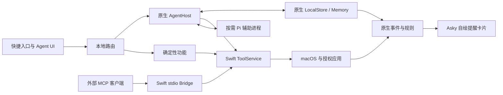

# Asky 产品框架与架构大纲

更新日期：2026 年 10 月 11 日。状态：当前模块架构；GitHub 插件与协议 v2 已实现，实际检查见[插件验证](validation/2026-10-11-plugins.md)。其他验收以各专题验证记录为准。

Asky 围绕“快速入口、按需理解、本地记忆、少量提醒”构建。确定性功能独立于模型和 Pi；原生主应用管理系统授权、工具执行、数据与资源，Agent 是按需启动且可替换的增强层。

产品行为以 [PRD](PRD.md) 为准，专题文档的职责与状态见 [文档索引](README.md)。

## 技术取舍与状态

| 项目 | 当前方案 | 状态 |
| --- | --- | --- |
| 平台 | macOS 15+、Apple Silicon，中文优先 | 26+ 使用液态玻璃；15 使用原生背景模糊，旧系统实机待验收，Intel 不承诺 |
| 原生界面 | Swift 6、SwiftUI + AppKit、NSPanel | 已确认技术方向，实际工程配置待建立 |
| 视觉 | 用户 Figma 变量与 Styles、原生 Liquid Glass | 已确认；[设计系统](design-system.md) |
| Agent | 优先验证 Pi Coding Agent SDK，本地 Node.js 辅助进程 | M0 通过后锁定，保持可替换 |
| 模型 | BYOK，OpenAI-compatible Chat Completions 优先 | 已确认协议方向，分项能力检查 |
| 持久化 | SQLite、全文索引、文件附件，Keychain 保存密钥 | 原生数据方向已确认；会话整合待验证 |
| 外部 MCP | 最小 stdio MCP 实现（官方 SDK 暂不可用）、stdio Bridge，经仅属主 Unix socket 连接应用 | 已实现；签名、真实客户端与权限归属待验证 |

全天候运行不等于 Agent 全天驻留，也不表示 SwiftUI 自动低占用。启动器可靠性与资源生命周期是独立工程约束；未验证前不承诺具体总内存、冷启动时间或耗电。

## 产品结构与模块

快捷入口和展开 Agent 共用一个原生浮动入口；历史、记忆、设置为辅助页面，菜单栏提供唤起、暂停与退出。隐藏、输入、搜索、对话、等待补充、等待确认、执行、结果是产品状态，不与辅助进程状态混为一谈。

| 模块 | 职责 | 必须独立的边界 |
| --- | --- | --- |
| Native Shell | 窗口、页面、菜单栏、快捷键、焦点、授权与确认 | 不持有全部历史、原图或所有搜索结果 |
| Intent Router | 本地关键词、表达式、显式命令与提交路由 | 普通输入不调用模型，不隐式执行 Shell |
| Search Providers | 应用、Spotlight、Chrome 与剪贴板 | 异步有限批次，旧查询可取消 |
| Direct Actions | 应用、URL、计算、单位、汇率、终端与 Shortcuts | 不依赖 Pi、模型或 MCP 启动 |
| AgentHost | 辅助进程启动退出、宿主通信、任务与 UI 事件适配 | Swift 业务不引用 Pi 内部类型 |
| Agent Runtime | 模型、上下文、工具编排与运行会话 | 按需运行，不拥有系统权限或整库私有数据 |
| ToolService | 参数、授权、确认、去重、执行、回读及可信插件执行 | Launcher、Agent、外部 MCP 共用同一策略 |
| LocalStore | 活动、产品历史投影、执行与计划 | 数据落盘，查询有界；对话唯一权威待 M0 固化 |
| Memory Engine | Markdown 索引与主题、对话提炼、纠正、删除及定期整理 | 原生管理；当前不保留逐条来源与替代链；仅在 AI 使用机会尝试提炼整理 |
| Context Scheduler | 事件检查、冲突、路线与提醒计划 | 先本地规则，默认不后台启动模型 |
| Resource Lifecycle | 作用域、缓存、队列、取消与清理 | 每个模块自行遵守归属与上限，不靠一个中央对象自动回收 |
| MCP Bridge | stdio 协议、实例、工具映射、本地连接 | 不独立读取系统数据，不公开所有内部能力 |

## 进程与执行边界

图中 Host / Pi 通道是受控本地宿主通信，已冻结为 stdio JSONL 协议 v2。Bridge 到 ToolService 当前经 Unix domain socket 连接。内部原生调用不必经过 MCP 序列化。

主应用保持系统授权与确认的主体。Pi 通过宿主调用原生工具，不直接访问受保护数据库。Bridge 验证接入实例并转交应用，应用未运行时返回可恢复的不可用状态。

插件既可向 Agent 提供工具，也可通过清单注册无需模型的启动器命令与动态搜索入口。启动器复用原生结果列表，所有插件调用仍经 ToolService；动态搜索只允许读工具。插件安装与执行由 ToolService 管理；官方插件独立仓库发布并按需安装，不进入应用包。插件执行进程用于生命周期管理，不是沙箱，详见[插件指南](plugins.md)。

正常常驻只有主应用及必要的轻量原生能力；Pi 仅在明确 AI 提交时启动，外部 MCP Bridge 由实际接入需要启动。不能为每个引擎建立长期驻留进程。网络、Apple Events、索引与数据库工作不阻塞 UI 主线程。

辅助进程生命周期详见 [Agent Runtime](agent-runtime.md)，每类资源的加载与释放详见 [资源生命周期](resource-lifecycle.md)。

## 主要概念接口

以下契约约束实现边界，不表示源码已经存在；具体 Swift 类型和通信编码在 M0 / 对应适配器验证后固化。

| 契约 | 必需内容 | 输出与约束 |
| --- | --- | --- |
| SearchResult | 来源、稳定目标标识、标题、说明、动作 | 异步批次；执行前校验目标 |
| ModelConfiguration | API 地址、模型名、Keychain 凭据引用、能力结果 | 文本、图像与工具调用分别判断 |
| AgentRequest / AgentEvent | 会话与任务关联、显式输入、附件引用、增量与完整结果 | 任务状态、工具状态、澄清、确认、取消与完成分开 |
| ToolDefinition / ActionRequest | 工具输入、数据源、读写效果、确认规则、请求标识与来源 | 共享登记和原生策略，不信任外部“已确认” |
| ExecutionResult | 完成、拒绝、取消、失败、待核实；目标引用与实际结果 | 写入回读，恢复前核实 |
| MemoryFolder（当前实现） | `MEMORY.md` 索引与按需读取的主题文件 | 整体来源开关；显式原文修改，自动提炼整理；删除联动仍需验收 |
| ReminderPlan | 事件、原因、依据、触发时间与状态 | 去重、取消、延后、恢复校验 |
| ResourceScope | 所有者、用途、成本、上限、释放与取消条件 | 保证重资源不会无界驻留 |

实际模型协议限制在 Runtime 适配中；原生工具、记忆与界面不使用特定厂商的消息格式。MCP 与宿主通信也不共用“客户端可自报批准”的执行捷径。

## 主要数据流

### 确定性搜索

输入进入本地 Router，各 Provider 在有限范围异步返回；新输入取消旧查询，迟到结果被丢弃。选择后校验目标并执行，面板隐藏、清理查询与预览资源。不启动 Pi，不因查询文本自动外发。

### 自然语言任务

明确提交后创建任务标识，AgentHost 启动或复用 Pi，提供允许的必要上下文。Runtime 组织模型与工具循环；每个工具转交 ToolService 检查，必要时原生确认，执行后回读并记录步骤。

完成后保存可恢复记录，释放临时上下文与默认截图。无任务、工具或操作确认时按默认 60 秒空闲窗口退出辅助进程；再提交时恢复必要会话，不重放旧写入。

取消不回滚已完成操作。超时或断开先核实目标再决定继续；部分完成、未执行和待核实分别显示。等待普通补充可持久化后退出，等待具体操作确认不适用空闲退出。

### 事件与提醒

授权事件、本地检查点、记忆变化与系统恢复触发原生规则，筛选冲突、路线或日期候选，核对类别、依据、数量、静默窗口与处理状态后安排 Asky 自绘提醒卡片。

默认不后台唤醒模型；需要模型的新候选进入有界队列，等待下次明确 AI 使用，或仅在用户另行启用后台 AI 后处理。规则检查与已有通知不因此停止。主应用退出后不发现新事件、也不弹出卡片，恢复时重新校验。

### 本地存储与外发

业务数据在 SQLite / 文件中持久化，密钥在 Keychain。按授权局部检索再提供模型上下文，不发送全库。派生摘要继承来源限制。活动自然过期与用户主动删除使用不同清理规则。

会话权威、SQLite 投影、Pi 压缩历史与附件外置必须先验证；避免两份完整历史同时驻留。详见 [数据、记忆与提醒](data-and-memory.md)。

## 设计决策与旧方案处理

| 旧表述或误区 | 当前规则 |
| --- | --- |
| 全 Swift 自研 Agent 为默认 | Pi SDK 优先验证，纯 Swift 作为备选 |
| 启用 AI 即启动常驻 Runtime | 配置、历史与页面不启动；明确请求按需启动 |
| 插件关闭等于依赖删除 | 资源加载、工具可达性和运行依赖分别核查 |
| Session dispose 即释放 Node | 真正退出受管理辅助进程并检查子进程 |
| 原生界面必然轻量 | 管理图片、消息、索引、缓存、任务与监听的生命周期 |
| AI 关闭后所有复杂提醒照常实时生成 | 本地规则与已安排通知继续，依赖模型的新建议延后 |
| 任务完成等于模型说“完成” | 以原生执行结果、回读及最终任务状态为准 |

## 开发门槛与专题

M0 先验证原生外壳、Pi、系统适配器、权限与连接、恢复和资源；M1 完成独立桌面入口，M2 完成 AI 与共用工具，M3 完成记忆，M4 完成情境提醒。详细通过条件与 A01–A27 映射见 [实施与验证](implementation-and-validation.md)。

界面实现阅读 [设计系统](design-system.md)；系统操作阅读 [原生工具与 MCP](native-tools-and-mcp.md)。当前不提供虚构安装、构建、测试或启动命令；实际工程建立后同步项目 README。
