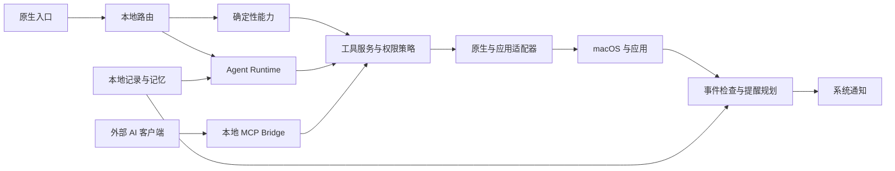

# KulaHere 产品框架与架构大纲

更新日期：2026 年 10 月 9 日。状态：V1 架构草案，尚未对应已实现模块。

KulaHere 的框架围绕“快速入口、按需理解、本地记忆、少量提醒”展开。确定性工具与 AI 具有不同的延迟和可靠性要求，因此快捷入口独立于模型运行，系统能力通过共用工具层提供给应用和本地 MCP。

功能范围与用户验收以[产品需求文档](PRD.md)为准。本文定义模块职责、进程边界、主要接口和实现顺序，不把技术预留视为首版功能承诺。

## 产品与界面结构

| 区域 | 承担的工作 | 边界 |
| --- | --- | --- |
| 快捷入口 | 输入、即时结果、选择与执行 | 不等待模型启动；不因输入自动发起 AI 请求 |
| Agent 对话 | 多轮理解、附件、工具执行、确认与结果 | 从快捷入口展开，支持单独快捷唤起动作 |
| 历史与记忆 | 找回对话、查看记忆来源、纠正和删除 | 辅助管理页面，日常使用不要求进入 |
| 设置 | 快捷键、来源、模型、隐私、命令、提醒和 MCP | 按需配置，不一次索取全部系统权限 |
| 菜单栏 | 唤起、暂停记录、暂停智能提醒、设置与退出 | 应用后台运行时保留轻量入口 |

入口状态依次包括隐藏、可输入、搜索结果、对话、等待补充、等待确认、执行中与执行结果。隐藏界面与取消任务是不同动作；工具状态不以模型输出中的一句“完成”作为最终依据。

## 模块职责

| 模块 | 职责 | 输出与依赖 |
| --- | --- | --- |
| Native Shell | SwiftUI 页面、AppKit 窗口、菜单栏、全局快捷键、焦点与系统授权 | 用户输入、显示状态、可信确认动作 |
| Intent Router | 本地关键词、表达式、显式命令与搜索路由 | 本地结果或已提交的 Agent 请求 |
| Search Providers | 应用、Spotlight 文件、Chrome 标签页和剪贴板检索 | 共用结果格式；各来源异步返回 |
| Direct Actions | 应用启动、目标切换、URL 搜索、计算换算、命令与 Shortcuts | 确定性的执行反馈 |
| Agent Runtime | 流式模型调用、上下文组织、多步工具调用、取消和恢复 | 对话与任务状态；仅按需运行 |
| Tool Service | 系统适配器、参数校验、授权、写入确认、执行和回读 | 应用内调用与 MCP 共用的工具结果 |
| Local Store | 对话、活动、记忆、执行记录与提醒计划 | SQLite 与全文索引；版本化迁移 |
| Memory Engine | 提炼、检索、来源追溯、纠错、替代与删除 | 可解释的情景与长期记忆 |
| Context Scheduler | 监听授权事件、筛选候选、检查冲突和生成提醒计划 | 无持续模型轮询；计划交给系统通知 |
| MCP Bridge | 本地 stdio 协议入口、接入实例配置和工具映射 | 不自行持有系统数据访问权，不绕过策略 |

### 共用执行边界

原生应用保持为系统授权与确认的归属主体。首版 MCP Bridge 作为独立命令入口，通过本地 IPC 向运行中的应用请求工具能力；实现优先采用 XPC。Bridge 不直接读取受保护数据库，也不替模型发起独立授权。应用未运行时返回可恢复的不可用状态，由用户启动应用后重试。

Launcher 不依赖 Bridge，应用内直接调用共用工具服务。Agent 使用异步任务与独立状态管理；网络等待、Apple Events 和数据库处理不阻塞主线程。先建立逻辑与任务隔离，不为每个引擎创建长期驻留进程。

XPC、辅助程序启动方式和签名身份必须在 M0 验证，尤其要确认权限提示归属、连接隔离和重启后的行为。后续公开分发需要保持稳定的签名与 bundle identity，不能把开发期的授权表现视为发布期保证。

## 主要接口与数据流

### 接口契约

| 接口 | 必需内容 | 行为要求 |
| --- | --- | --- |
| Search Result | 来源类型、稳定目标标识、标题、次要说明、可执行动作 | 异步批次更新；执行前重新校验文件或标签目标 |
| Model Configuration | API 地址、模型名、Keychain 中的凭据引用、能力检查结果 | 区分对话、图像与工具调用；不把密钥传给工具服务或 MCP |
| Tool Definition | 工具名、输入定义、所需数据源权限、读写效果、确认要求 | 同一登记信息驱动应用调用和 MCP 暴露范围 |
| Action Request | 工具、参数、请求来源、请求标识与用户意图关联 | 外部参数不能声明自己已经获得原生确认 |
| Execution Result | 状态、目标引用、实际结果、错误或待核实原因 | 区分完成、拒绝、取消、失败和结果待核实；写入后回读 |
| Memory Record | 内容、类型、来源、时间、确认状态、替代关系 | 用户纠正优先；删除与索引清理保持一致 |
| Reminder Plan | 事件标识、原因、依据、触发时间、状态 | 可去重、取消、延后；事件变化后重新校验 |

模型通信适配器提供流式回答、图片输入和工具调用能力，首版以一个可配置的兼容 API 接口完成闭环。具体模型由用户配置；不创建模型聚合市场或托管服务。实现时将协议转换留在适配器内部，产品和系统工具层不依赖某个模型厂商的数据格式。

### 一次自然语言任务

1. 用户提交任务，记录本地任务标识和当前上下文。
2. 本地检索相关记忆与允许的系统来源，组装必要上下文。
3. 模型提出工具调用；共用工具服务校验参数、目标与策略。
4. 缺少必要信息时请求补充；需要确认时生成绑定具体操作的原生确认。
5. 执行工具并回读结果，保存已完成步骤和目标引用，再反馈给用户。
6. 根据已启用的来源提炼可保留记忆，撤销临时附件与无用上下文。

写入调用使用请求标识防止重复执行。超时或断开后先核实目标是否已经写入，再决定是否重试；取消不会回滚已完成步骤，恢复执行只继续未完成且仍获授权的步骤。

外部工具内容、网页、备忘录和检索结果均作为数据处理，不能修改工具范围、获取确认或要求读取额外来源。模型的提示词不能替代运行时策略检查。

### 一次事件提醒

1. 授权数据变化或计划检查时间到达，取得必要事件快照。
2. 本地规则检查时间重叠、准备窗口、路线条件与既有提醒。
3. 仅对需要理解的候选检索相关记忆并调用模型；时间计算、去重和是否已处理保持确定性。
4. 检查依据、类别开关、提醒窗口和数量限制，生成可追溯计划。
5. 注册系统本地通知，事件更新时取消或替换原计划。
6. 应用恢复、时区变化或权限撤销时重新校验计划。

应用停止运行时，只能交付已经注册的通知，不能保证实时发现新冲突；退出前提示这一差异，提供单独的登录启动设置。

## 系统适配器与验证门禁

| 能力 | 首选实现 | M0 与集成验证重点 |
| --- | --- | --- |
| 窗口与快捷键 | SwiftUI 与 AppKit，系统全局快捷键注册 | 快捷键占用、多屏焦点、窗口层级、键盘与辅助功能 |
| 应用与文件 | NSWorkspace 与 Spotlight 元数据查询 | 搜索范围、无权限文件、目标移动与失效 |
| Chrome 标签页 | Chrome 的 Apple Events 脚本对象 | 标题、URL、窗口、标签切换；排除无痕；无需执行网页 JavaScript |
| 计算与换算 | 本地受限表达式与单位转换 | 不执行输入代码；无效输入返回搜索 |
| 终端与 Shortcuts | 显式子进程执行及系统快捷指令接口 | 工作目录、取消、错误输出与退出状态；交互命令交接 |
| 剪贴板 | NSPasteboard，用户授权后的粘贴动作 | 敏感标记、排除应用、容量、图片与权限撤销 |
| 日历与提醒事项 | EventKit | 读写范围、只读清单、重复事件、时区、变更通知与回读 |
| 联系人 | Contacts | 允许范围、同名、多号码和用户确认的关系映射 |
| 备忘录 | Notes 的 Apple Events 脚本对象 | 授权账户和文件夹、文本读取与追加、目标失效；不处理锁定内容 |
| Messages 交接 | 打开目标会话及经验证的草稿预填，失败时复制正文 | 正确收件人、Unicode、正文交接、最终发送始终人工完成 |
| 截图与识图 | ScreenCaptureKit，按任务传入支持图片的模型 | 用户主动选择、权限、取消与临时图像清理 |
| 路线与通知 | MapKit 与 UserNotifications | 地点、起点、有效 ETA、网络失败、过期计划撤销 |

本机系统应用的脚本定义包含 Notes 的正文与文件夹、Chrome 的标签页与窗口，以及 Messages 的发送命令。Messages 的该定义没有完整消息历史读取对象；因此 V1 采用草稿交接，消息历史不进入首版工具接口。脚本定义表示存在能力入口，仍需 M0 验证实际执行与授权行为。

系统权限采用逐项、按需授权。日历与提醒事项使用正式 EventKit 接口；截图使用 ScreenCaptureKit；应用自动化需要 Apple Events 用途声明。相关能力不通过直接读取其他应用的私有数据库实现。[EventKit](https://developer.apple.com/documentation/eventkit/ekeventstore/requestfullaccesstoreminders(completion:)), [ScreenCaptureKit](https://developer.apple.com/documentation/screencapturekit), [Apple Events 权限](https://developer.apple.com/documentation/bundleresources/information-property-list/nsappleeventsusagedescription)

## MCP 与权限策略

独立本地 MCP 使用官方 Swift SDK 的 stdio 传输。日志使用 stderr，stdout 只传协议消息；不开放远程网络服务。[Swift MCP SDK](https://github.com/modelcontextprotocol/swift-sdk)

首版工具分组为日历、提醒事项、备忘录、联系人、Chrome 标签页和 Messages 草稿交接。读取与写入分别控制；工具清单只包含该接入实例可用的能力。Messages 草稿交接需要对应授权和原生确认，不提供直接发送工具。

| 请求来源与操作 | 处理策略 |
| --- | --- |
| 应用内读取 | 在用户启用的数据源范围内执行 |
| 用户明确要求的新建日程、提醒或备忘录 | 必要参数明确、无冲突且目标可写时执行并回读 |
| 修改既有内容、删除或批量变更 | 展示目标和变更，由用户确认 |
| AI 推导出的新增系统写入 | 先展示建议，不能视为用户已要求创建 |
| 外部 MCP 读取 | 校验接入实例及数据源范围后执行 |
| 外部 MCP 写入 | 必须通过 KulaHere 原生确认；确认只对当前具体请求有效 |
| 消息发送 | 仅准备草稿和交接，最终在 Messages 中由用户执行 |

接入实例不能仅凭客户端声明的名称获得身份或权限。M0 应验证通过独立接入凭据与本地 IPC 连接校验识别实例，并支持撤销连接；取消或拒绝确认不得重试为自动执行。

MCP 不公开完整个人记忆、剪贴板、模型配置密钥或任意 Shell。内部终端快捷工具与外部 MCP 的工具暴露范围明确分开。

## 本地数据与隐私

SQLite 保存对话、活动、记忆、工具记录与提醒计划，全文索引承担首版检索。文件附件单独存放并关联生命周期；截图默认临时。API Key 与接入凭据使用 Keychain，不进入业务数据库和导出包。

系统应用继续作为日程、提醒事项、联系人和备忘录的权威来源；本地快照仅用于当前任务、已启用的记忆来源或提醒校验。用户在系统应用中的修改与删除必须反映到缓存和提醒计划。

数据源设置区分读取、AI 使用、自动提炼和后台提醒。自动提炼使用云端模型时仍需 AI 授权，摘要和派生记忆继承来源的外发限制。撤销系统权限后停止读取；删除来源授权时让用户决定是否保留既有独立记忆，已失去依据的提醒取消。主动删除来源或记忆应同步清理摘要、索引和衍生关系，并防止自动重建。原始活动按保留期限到期，不自动删除已获准长期保存的独立记忆，来源状态改为已过期。

云端模型请求在本地检索与筛选后生成，不能发送整个数据库。地图请求只携带路线计算所需地点。诊断信息不记录密钥和完整私人正文；首版保留本地检查，不建立遥测后台。

## 开发顺序与交付物

1. **M0 能力验证**：配置完整 Xcode；验证原生外壳、适配器、权限归属、XPC 与 MCP 连接，以及 Messages 草稿交接。
2. **M1 确定性入口**：先完成搜索、命令、小工具和剪贴板，并验证 AI 关闭时的完整主流程。
3. **M2 AI 与系统工具**：接入 BYOK 对话、附件、工具状态和回读，再接通共用工具的本地 MCP。
4. **M3 记忆**：建立来源与替代关系，完成本地检索、纠错、删除和项目上下文测试。
5. **M4 提醒**：先做本地日程冲突，再接入路线与重要日期准备；验证安静交付与过期计划取消。

每阶段交付可运行的自用构建、对应验收结果和已知限制。构建、测试和启动命令只在实际项目配置建立后写入开发说明；不把文档中的模块名当成现有源码或可执行命令。
